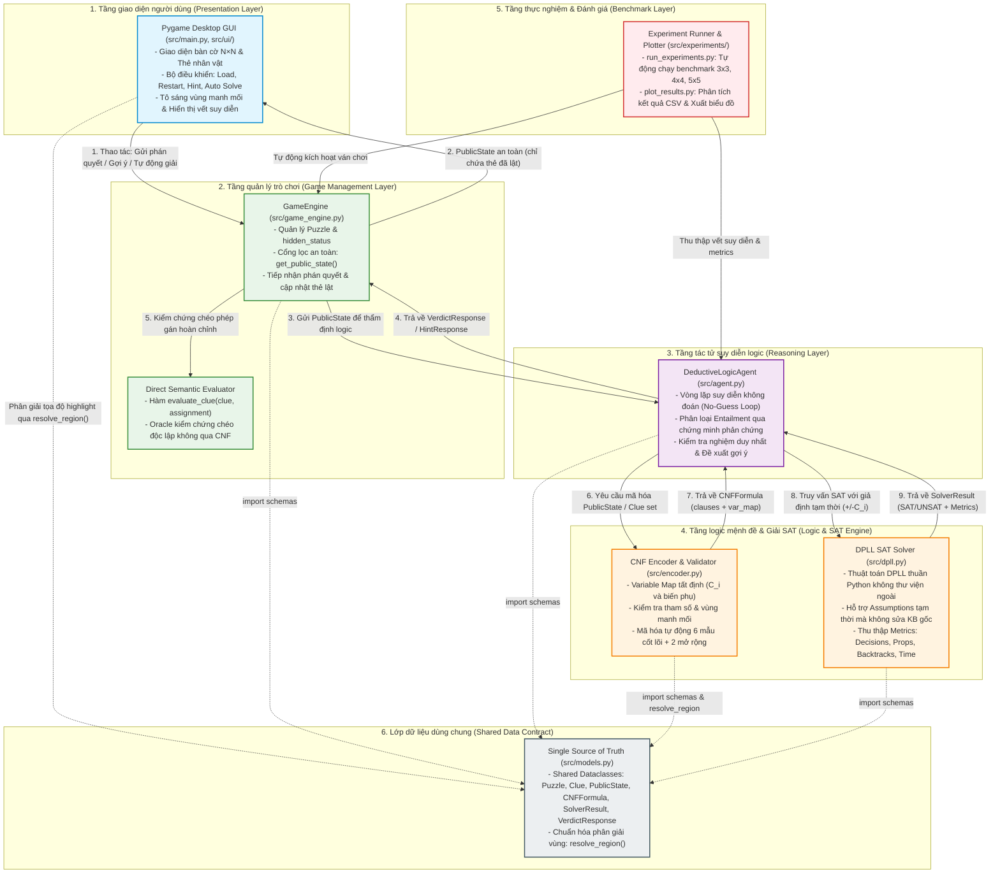

CSC14003 — Introduction to Artificial Intelligence: Project 2 — Griductive Solver

1. Lập kế hoạch dự án và Phân chia công việc (Project Planning and Task Distribution)

1.1. Tổng quan kế hoạch và Lộ trình thực hiện

Dự án được thực hiện bởi nhóm 5 sinh viên với toàn bộ quá trình triển khai chia làm 3 giai đoạn liên tiếp từ ngày 18/11/2026 đến 28/11/2026:

| Giai đoạn | Ngày | Nội dung thực hiện |
| :--- | :--- | :--- |
| **Giai đoạn 1**<br>(18/11 – 22/11)<br>*Thiết kế kiến trúc và cài đặt các module độc lập* | 19/11 | Hoàn thiện `src/models.py`, xác định các cấu trúc dữ liệu dùng chung (`Puzzle`, `Clue`, `PublicState`, `CNFFormula`, `SolverResult`, `VerdictResponse`, `HintResponse`, `DeductionStep`) cùng hàm chuẩn hóa vùng `resolve_region()`. |
| | 20/11 | Xây dựng tập dữ liệu kiểm thử khói gồm 2 puzzle mẫu (`sample_3x3.json`, `sample_4x4.json`); hoàn thành bảng ánh xạ biến tất định và bộ kiểm tra tính hợp lệ của manh mối (`src/encoder.py`). |
| | 21/11 | Cài đặt và kiểm thử bộ giải DPLL SAT Solver thuần Python (`src/dpll.py`). |
| | 22/11 | Hoàn tất Game Engine, bộ thẩm định ngữ nghĩa trực tiếp (`src/game_engine.py`) và bộ mã hóa CNF tự động (`src/encoder.py`). |
| **Giai đoạn 2**<br>(23/11 – 25/11)<br>*Tích hợp tác tử logic, xây dựng dữ liệu benchmark và giao diện* | 23/11 | Cài đặt thuật toán phân loại hệ quả logic và hàm kiểm tra tính duy nhất của nghiệm (`check_uniqueness`) trong `src/agent.py`; dựng khung giao diện đồ họa GUI trong `src/main.py`. |
| | 24/11 | Hoàn thiện vòng lặp suy diễn không đoán, cơ chế sinh gợi ý và xuất vết suy diễn; thẩm định tập dữ liệu câu đố benchmark kích thước 3x3, 4x4 và 5x5 đảm bảo mỗi câu đố có nghiệm duy nhất. |
| | 25/11 | Tích hợp toàn diện giao diện với Game Engine và Agent; hỗ trợ thao tác gán phán quyết thủ công, tô sáng vùng manh mối và chế độ giải tự động; chạy kiểm thử tích hợp toàn hệ thống. |
| **Giai đoạn 3**<br>(26/11 – 28/11)<br>*Thực nghiệm, đánh giá và đóng gói* | 26/11 | Chạy benchmark tự động trên toàn bộ tập dữ liệu, xuất bảng số liệu 6 nhóm chỉ số ra tập tin CSV. |
| | 27/11 | Lập biểu đồ trực quan hóa dữ liệu thực nghiệm, hoàn thiện các phần nội dung của báo cáo kỹ thuật và ghi hình video minh họa chức năng hệ thống. |
| | 28/11 | Rà soát toàn bộ mã nguồn trên môi trường thực thi sạch, hoàn thiện tài liệu hướng dẫn và đóng gói nộp bài. |

1.2. Bảng phân công công việc và Tỷ lệ hoàn thành của từng thành viên

| Thành viên | MSSV | Trách nhiệm chính | Sản phẩm bàn giao | Tỷ lệ hoàn thành |
| :--- | :---: | :--- | :--- | :---: |
| **Nguyễn Duy Hào** | 24120306 | Quản lý schema dùng chung, Game Engine, Direct Semantic Evaluator, tập dữ liệu puzzle (3x3, 4x4, 5x5), đóng gói dự án. | `src/models.py`, `src/game_engine.py`, `src/puzzles/*.json`, mục 1 và 2 báo cáo, `README.md`. | 100% |
| **Bùi Đặng Khả Tuân** | 24120236 | Ánh xạ biến tất định, bộ kiểm tra tính hợp lệ của manh mối, bộ mã hóa CNF tự động (6 mẫu cốt lõi và 2 mở rộng). | `src/encoder.py`, `src/tests/test_encoder.py`, mục 3 báo cáo. | 100% |
| **Đinh Sỹ Bảo** | 24120262 | Bộ giải DPLL SAT Solver thuần Python, hỗ trợ giả định, ghi nhận metrics, xây dựng kịch bản benchmark tự động. | `src/dpll.py`, `src/tests/test_dpll.py`, `src/experiments/run_experiments.py`, mục 4.1 báo cáo. | 100% |
| **Nguyễn Đình Tuấn** | 24120237 | Tác tử suy diễn logic, phân loại hệ quả logic, kiểm tra nghiệm duy nhất, vòng lặp suy diễn không đoán, tạo vết suy diễn và gợi ý. | `src/agent.py`, `src/tests/test_agent.py`, mục 4.2 đến 4.4 báo cáo. | 100% |
| **Nguyễn Minh Khoa** | 24120073 | Giao diện đồ họa người dùng, tương tác bàn cờ, trực quan hóa manh mối, tổng hợp biểu đồ thực nghiệm, ghi hình video demo. | `src/main.py`, `src/experiments/plot_results.py`, mục 5 báo cáo, video demo minh họa. | 100% |

1.3. Kiến trúc hệ thống và Giao diện giữa các module

Hệ thống được tổ chức theo kiến trúc phân tầng rõ ràng, đặt toàn bộ mã nguồn thực thi bên trong thư mục `src/`. Tất cả các module giao tiếp với nhau thông qua hợp đồng dữ liệu chuẩn hóa tại `src/models.py`.



**Chú giải sơ đồ (Diagram Legend):**
- **Luồng dữ liệu thời gian thực (Mũi tên nét liền `-->`):** Biểu diễn các lời gọi phương thức và luồng trao đổi dữ liệu giữa các module trong quá trình thực thi, được đánh số từ 1 đến 9 theo thứ tự tương tác.
- **Quan hệ phụ thuộc tĩnh (Mũi tên nét đứt `-.->`):** Thể hiện các module import và sử dụng chung các cấu trúc dữ liệu (`dataclass`) hoặc hàm chuẩn hóa vùng `resolve_region()` từ hạt nhân `src/models.py`.
- **Quy ước màu sắc (Color Coding):**
  - *Xanh lam nhạt:* Tầng giao diện người dùng (Presentation Layer).
  - *Xanh lá nhạt:* Tầng quản trị trò chơi & Thẩm định ngữ nghĩa trực tiếp (Game Management Layer).
  - *Tím nhạt:* Tầng tác tử suy diễn logic không đoán (Reasoning Layer).
  - *Cam nhạt:* Tầng mã hóa mệnh đề CNF & Bộ giải SAT DPLL (Logic & SAT Engine).
  - *Đỏ nhạt:* Tầng chạy thực nghiệm tự động & Vẽ biểu đồ (Benchmark Layer).
  - *Xám nhạt:* Hạt nhân dữ liệu dùng chung - Single Source of Truth (`src/models.py`).

**Giải thích chi tiết kiến trúc và luồng dữ liệu:**

1. **Lớp dữ liệu dùng chung (`src/models.py` - Single Source of Truth):**
   - Đóng vai trò hạt nhân dữ liệu cho toàn bộ hệ thống, định nghĩa duy nhất các lớp dữ liệu trao đổi giữa các tầng: `Puzzle`, `Clue`, `PublicState`, `CNFFormula`, `SolverResult`, `VerdictResponse`, `HintResponse`, `DeductionStep`.
   - Cung cấp hàm `resolve_region(region, size)` chuẩn hóa việc phân giải tọa độ cho tất cả các loại vùng (`ROW`, `COL`, `NEIGHBORS`, `EXPLICIT`), đảm bảo tính nhất quán tuyệt đối giữa Game Engine, Bộ mã hóa CNF và Tầng giao diện người dùng (tô sáng vùng).

2. **Tầng quản lý trò chơi (`src/game_engine.py`):**
   - Lớp `GameEngine` nắm giữ toàn bộ trạng thái gốc của bàn cờ, bao gồm danh tính bí mật của nhân vật (`hidden_status`) và các manh mối úp chưa được tiết lộ.
   - **Nguyên tắc ẩn giấu thông tin nghiêm ngặt (Strict Information Hiding):** Phương thức `get_public_state()` chỉ xuất bản sao `PublicState` gồm các manh mối đã lật và phán quyết đã chứng minh; tuyệt đối không tiết lộ thông tin ẩn cho Logic Agent hay GUI.
   - **Direct Semantic Evaluator (`evaluate_clue`):** Cung cấp cơ chế thẩm định trực tiếp giá trị chân lý của một manh mối trên một phép gán hoàn chỉnh hoàn toàn độc lập với việc mã hóa CNF, đóng vai trò oracle đối chiếu chéo tính đúng đắn của bộ mã hóa.

3. **Tầng tác tử suy diễn logic (`src/agent.py`):**
   - Lớp `DeductiveLogicAgent` chỉ tiếp nhận `PublicState` từ Game Engine.
   - Thực hiện phương pháp phản chứng thông qua truy vấn SAT để phân loại trạng thái logic của từng ô (`CRIMINAL`, `INNOCENT`, `UNKNOWN`, `INCONSISTENT`).
   - Điều phối **Vòng lặp suy diễn không đoán (No-Guess Deduction Loop)**, kiểm tra tính duy nhất của nghiệm bài toán (`check_uniqueness`), tạo danh sách vết suy diễn chi tiết (`DeductionStep`) và sinh gợi ý nước đi (`HintResponse`).

4. **Tầng mã hóa logic và Giải SAT (`src/encoder.py`, `src/dpll.py`):**
   - **CNF Encoder (`src/encoder.py`):** Thiết lập ánh xạ biến tất định theo thứ tự quét hàng, tách biệt biến chính $C_i$ (từ $1$ đến $N^2$) và biến phụ (từ $N^2+1$ trở đi); thẩm định hợp lệ tham số manh mối; chuyển đổi tự động 6 mẫu manh mối cốt lõi và 2 mẫu mở rộng thành công thức chuẩn hội `CNFFormula`.
   - **DPLL SAT Solver (`src/dpll.py`):** Bộ giải DPLL tự cài đặt thuần Python (không phụ thuộc thư viện ngoài), hỗ trợ cơ chế giả định tạm thời (assumptions) để kiểm tra $KB_t \land C_i$ và $KB_t \land \neg C_i$ mà không làm biến dạng công thức gốc, đồng thời đo lường chính xác 4 chỉ số hiệu năng (`decisions`, `propagations`, `backtracks`, `runtime_ms`).

5. **Tầng giao diện người dùng (`src/main.py`, `src/ui/`):**
   - Ứng dụng đồ họa Pygame (`GriductiveApp`) tương tác với Game Engine qua `AgentAdapter`.
   - Hiển thị trực quan lưới ô cờ $N \times N$, phân biệt thẻ úp/ngửa, tô sáng các ô thuộc vùng manh mối được chọn thông qua `resolve_region()`, hỗ trợ người chơi gán phán quyết thủ công, nhận phản hồi trạng thái (`NOT_PROVABLE`, `CONTRADICTED`), yêu cầu gợi ý (`Hint`) và chế độ tự động giải (`Auto Solve`) kèm hiển thị vết suy diễn từng bước.

6. **Tầng thực nghiệm và đánh giá (`src/experiments/`):**
   - Module `run_experiments.py` tự động hóa việc chạy kiểm thử và benchmark bộ giải trên toàn bộ tập dữ liệu câu đố kích thước 3×3, 4×4 và 5×5, ghi nhận đầy đủ 6 nhóm chỉ số thực nghiệm ra tệp CSV.
   - Module `plot_results.py` xử lý dữ liệu CSV để vẽ biểu đồ phân tích hiệu năng và độ phức tạp tính toán của thuật toán.

2. Phát biểu bài toán (Problem Formulation)

2.1. Biến mệnh đề (Propositional Variables)

Bàn cờ kích thước $N \times N$ gồm các ô tọa độ $(r, c)$, với hàng $r \in \{0, \ldots, N-1\}$ và cột $c \in \{0, \ldots, N-1\}$. Ký hiệu hiển thị quy ước cột theo chữ cái (A, B, C,...) và hàng theo số bắt đầu từ 1. Mỗi ô chứa một nhân vật có trạng thái danh tính ẩn thuộc tập $\{\text{CRIMINAL}, \text{INNOCENT}\}$.

Với mỗi nhân vật tại vị trí $i$, đặt một biến Boolean chính $C_i$:
- $C_i = \text{True}$: nhân vật tại ô $i$ là `CRIMINAL`.
- $C_i = \text{False}$: nhân vật tại ô $i$ là `INNOCENT`.

Ánh xạ biến chính được thiết lập tất định theo thứ tự quét hàng (row-major order): ô tại hàng $r$, cột $c$ nhận chỉ số định danh $v = r \cdot N + c + 1$. Tổng số biến chính của bàn cờ là $N^2$. Trong quá trình chuyển đổi các ràng buộc đếm hoặc ràng buộc mở rộng sang CNF, các biến phụ (auxiliary variables) được cấp phát chỉ số bắt đầu từ $N^2 + 1$. Các biến phụ này phục vụ mục đích biểu diễn logic ngưỡng và được tách biệt hoàn toàn khỏi tập biến chính, bảo đảm không làm biến dạng phép chiếu nghiệm trên các nhân vật của bài toán.

2.2. Ngôn ngữ manh mối cốt lõi và Phần mở rộng (Clue Language & Extensions)

Mỗi manh mối áp dụng trên một vùng ô $R \subseteq \{1, \ldots, N^2\}$. Hàm `resolve_region(region, size)` xác định tập các ô thuộc $R$ dựa trên 4 loại cấu trúc:
- `ROW`: Tập hợp tất cả các ô trên cùng một chỉ số hàng.
- `COL`: Tập hợp tất cả các ô trên cùng một chỉ số cột.
- `NEIGHBORS`: Tập hợp các ô kề cạnh hoặc kề góc với ô chỉ định (tối đa 8 ô lân cận, không chứa chính ô chỉ định).
- `EXPLICIT`: Danh sách các tọa độ ô được liệt kê cụ thể.

Sáu mẫu manh mối cốt lõi bao gồm:
- `FACT`: Xác định trực tiếp trạng thái của một nhân vật. Biểu diễn logic tương đương mệnh đề đơn $C_i$ (nếu `CRIMINAL`) hoặc $\neg C_i$ (nếu `INNOCENT`).
- `SAME`: Hai nhân vật có cùng trạng thái danh tính: $C_a \leftrightarrow C_b$.
- `DIFFERENT`: Hai nhân vật có trạng thái đối lập: $C_a \oplus C_b$.
- `EXACTLY`: Số lượng nhân vật `CRIMINAL` trong vùng $R$ bằng đúng $k$: $\sum_{i \in R} C_i = k$ (với $0 \le k \le |R|$).
- `AT_LEAST`: Số lượng nhân vật `CRIMINAL` trong vùng $R$ tối thiểu là $k$: $\sum_{i \in R} C_i \ge k$.
- `AT_MOST`: Số lượng nhân vật `CRIMINAL` trong vùng $R$ tối đa là $k$: $\sum_{i \in R} C_i \le k$.

Hai mẫu manh mối mở rộng được nhóm xây dựng thêm:
- `PARITY`: Tính chẵn lẻ của tổng số `CRIMINAL` trong vùng $R$:
  $$\bigoplus_{i \in R} C_i = \begin{cases} 1 & \text{khi manh mối là ODD} \\ 0 & \text{khi manh mối là EVEN} \end{cases}$$
- `COMPARE_COUNT`: So sánh tương quan số lượng `CRIMINAL` giữa hai vùng $R_1$ và $R_2$ qua toán tử $op \in \{\text{GT}, \text{LT}, \text{EQ}\}$:
  $$\sum_{i \in R_1} C_i > \sum_{j \in R_2} C_j \quad (\text{GT}), \quad \sum_{i \in R_1} C_i < \sum_{j \in R_2} C_j \quad (\text{LT}), \quad \sum_{i \in R_1} C_i = \sum_{j \in R_2} C_j \quad (\text{EQ})$$

2.3. Cơ sở tri thức (Knowledge Base)

Tại mỗi bước suy diễn $t$, cơ sở tri thức công khai $KB_t$ được xây dựng thuần túy từ thông tin đã được tiết lộ:
$$KB_t = \left( \bigwedge_{c \in \mathcal{C}_t} \text{CNF}(c) \right) \land \left( \bigwedge_{v \in \mathcal{V}_t} \text{unit}(v) \right)$$
trong đó $\mathcal{C}_t$ là tập hợp các manh mối đã lật mở, $\mathcal{V}_t$ là tập hợp các phán quyết đã được chứng minh hợp lệ, và $\text{unit}(v)$ là mệnh đề đơn biểu diễn phán quyết ($C_i$ nếu `CRIMINAL`, $\neg C_i$ nếu `INNOCENT`).

Cơ sở tri thức $KB_t$ tuân thủ các nguyên lý:
- Không đưa thông tin chưa lật hoặc trạng thái ẩn vào $KB_t$.
- Phân biệt giữa nghiệm thỏa mãn (satisfying model) và hệ quả logic (entailment): Một mô hình thỏa mãn chỉ là một khả năng gán giá trị hợp lệ cho các biến. Phán quyết về trạng thái của nhân vật $i$ chỉ được chấp nhận khi trạng thái đó đúng trong toàn bộ các mô hình của $KB_t$, tức $KB_t \models C_i$ hoặc $KB_t \models \neg C_i$.

2.4. Giao thức tiết lộ và Vòng lặp suy diễn (Reveal Protocol & Deduction Loop)

Việc kiểm tra hệ quả logic cho nhân vật $i$ tại bước $t$ được chuyển về bài toán kiểm tra tính thỏa được của công thức CNF bằng phương pháp phản chứng:
- $KB_t \models C_i \iff KB_t \land \neg C_i$ là UNSAT. Khi đó, nhân vật $i$ được chứng minh là `CRIMINAL`.
- $KB_t \models \neg C_i \iff KB_t \land C_i$ là UNSAT. Khi đó, nhân vật $i$ được chứng minh là `INNOCENT`.
- Nếu cả hai bài toán đều SAT, trạng thái của ô $i$ là `UNKNOWN`, chưa thể đưa ra kết luận logic từ $KB_t$.
- Nếu bản thân $KB_t$ là UNSAT, trạng thái là `INCONSISTENT`, chỉ ra cơ sở tri thức chứa mâu thuẫn.

Giao thức phản hồi phán quyết của trò chơi hoạt động như sau:
1. Khi người chơi hoặc tác tử gửi phán quyết cho ô $i$, hệ thống kiểm tra hệ quả logic từ $PublicState$.
2. Nếu phán quyết trùng với trạng thái bị bắt buộc (`ENTAILED`), phán quyết được chấp nhận. Thẻ tại ô $i$ được lật mở, manh mối mới được tiết lộ và cập nhật vào $KB_{t+1}$.
3. Nếu trạng thái ô $i$ là `UNKNOWN`, phán quyết bị từ chối với lý do `NOT_PROVABLE`. Trạng thái bàn cờ giữ nguyên, không lật thẻ và không để lộ thông tin manh mối ẩn.
4. Nếu trạng thái ô $i$ bị bắt buộc theo chiều ngược lại, phán quyết bị từ chối với lý do `CONTRADICTED`. Trạng thái bàn cờ giữ nguyên.

Vòng lặp suy diễn không đoán (No-Guess Deduction Loop) tự động hóa quá trình giải:
1. Bắt đầu tại $t = 0$ với các manh mối ban đầu được lật mở.
2. Duyệt qua các ô chưa giải theo thứ tự tất định (hàng trước, cột sau).
3. Với mỗi ô, kiểm tra hai truy vấn SAT tương ứng. Ngay khi phát hiện một ô có trạng thái bị bắt buộc, thực hiện phán quyết, lật thẻ ô đó, ghi nhận bước suy diễn (`DeductionStep`), cập nhật sang $KB_{t+1}$ và tiếp tục bước $t+1$.
4. Vòng lặp kết thúc thành công khi tất cả các ô được giải quyết. Nếu toàn bộ các ô chưa giải đều ở trạng thái `UNKNOWN`, bộ giải dừng lại và thông báo không thể giải tiếp mà không đoán.

3. Mã hóa CNF (CNF Encoding)

3.1. Ánh xạ biến tất định và Kiểm tra hợp lệ (Variable Mapping & Validation)

Mỗi ô trên lưới $N \times N$ có một biến chính, với giá trị `True` nếu nhân vật là `CRIMINAL`. ID được cấp từ 1 đến $N^2$ theo thứ tự hàng rồi cột. Các biến phụ bắt đầu từ $N^2+1$. Trước khi mã hóa, bộ kiểm tra xác thực tham số manh mối và dùng `resolve_region()` để xác định vùng. Với manh mối đếm, điều kiện hợp lệ là $0 \le k \le |R|$.

`encode_public_state()` ghép CNF của các manh mối đã mở với một mệnh đề đơn cho mỗi phán quyết đã chứng minh. `CNFFormula` ghi số biến chính, số biến phụ và số mệnh đề của cơ sở tri thức tại bước đó.

3.2. Phương pháp mã hóa lực lượng (Cardinality Encoding)

Với vùng gồm các biến $x_1,\ldots,x_m$, đặt $T_{i,j}$ là biến cho biết có ít nhất $j$ người `CRIMINAL` trong $i$ ô đầu. Khi xét thêm ô $i$, ta có $T_{i,j} \leftrightarrow T_{i-1,j} \lor (T_{i-1,j-1} \land x_i)$. Hai biên là $T_{i,0}=\mathrm{True}$ và $T_{i,j}=\mathrm{False}$ khi $j>i$.

`AT_LEAST(k)` đặt $T_{m,k}$ thành đúng, `AT_MOST(k)` đặt $T_{m,k+1}$ thành sai, còn `EXACTLY(k)` áp dụng cả hai cận. Cận đếm yêu cầu cả vùng cùng đúng hoặc cùng sai được mã hóa bằng các mệnh đề đơn. Nếu cần đến mức $\ell$, số mệnh đề cho bảng ngưỡng là $O(m\ell)$.

3.3. Suy dẫn manh mối hai ngôi (Binary Clue Derivation)

Với `SAME(A1, B1)`, gọi $a$ và $b$ là hai biến tương ứng. Điều kiện $a\leftrightarrow b$ tương đương $(a\Rightarrow b)\land(b\Rightarrow a)$. Thay mỗi phép kéo theo bằng phép tuyển, ta được $(\neg a\lor b)\land(a\lor\neg b)$.

3.4. Suy dẫn manh mối đếm (Counting Clue Derivation)

Xét `EXACTLY(2)` trên ba ô có biến $a,b,c$. Đặt $p\leftrightarrow(a\lor b)$ và $q\leftrightarrow(a\land b)$ cho hai ngưỡng trong hai ô đầu. Khi thêm $c$, ngưỡng ít nhất hai là $t\leftrightarrow(q\lor(p\land c))$, còn ngưỡng ít nhất ba là $u\leftrightarrow(q\land c)$.

Chiều $q\lor(p\land c)\Rightarrow t$ sinh hai mệnh đề $(\neg q\lor t)$ và $(\neg p\lor\neg c\lor t)$. Chiều ngược lại sinh $(\neg t\lor q\lor p)$ và $(\neg t\lor q\lor c)$. Mã hóa tương đương cho $p,q,u$ rồi thêm hai mệnh đề đơn $(t)$ và $(\neg u)$ để buộc đúng hai ô.

3.5. Mã hóa các phần mở rộng (Extensions Encoding)

- `PARITY` nối các phép XOR theo thứ tự ô trong vùng. Mỗi biến $z\leftrightarrow(a\oplus b)$ sinh bốn mệnh đề $(a\lor b\lor\neg z)$, $(\neg a\lor\neg b\lor\neg z)$, $(a\lor\neg b\lor z)$ và $(\neg a\lor b\lor z)$. Cố định kết quả cuối thành đúng cho `ODD` và sai cho `EVEN`.
- `COMPARE_COUNT` tạo hai dãy biến ngưỡng $L_j$ và $R_j$. Với `GT`, thêm $(L_1)$ và các mệnh đề $(\neg R_j\lor L_{j+1})$. Nếu $j+1$ vượt kích thước vùng trái, mệnh đề còn lại là $(\neg R_j)$. `LT` đổi vai trò hai vùng. `EQ` buộc hai vùng đạt cùng ngưỡng bằng hai chiều $L_j\leftrightarrow R_j$, với ngưỡng vượt kích thước vùng được xem là sai.

4. Thuật toán (Algorithms)

4.1. Bộ giải DPLL SAT Solver

Bộ giải được cài đặt bằng Python thuần trong `src/dpll.py`, không dùng thư viện SAT/CSP bên ngoài. Đầu vào là một `CNFFormula` (hoặc danh sách mệnh đề `list[list[int]]`) cùng danh sách giả định (assumptions) tùy chọn. Đầu ra là `SolverResult` gồm `status` (`SAT`/`UNSAT`), `assignment` (phép gán hoàn chỉnh khi SAT) và bốn chỉ số `decisions`, `propagations`, `backtracks`, `runtime_ms`.

**Tiền xử lý.** Lớp `DPLLSolver` chuẩn hóa công thức một lần khi khởi tạo. Literal phải là số nguyên khác 0. Literal lặp trong cùng mệnh đề bị loại, mệnh đề hằng đúng (chứa cả $x$ và $\neg x$) bị bỏ qua, và mệnh đề rỗng được đánh dấu để trả về UNSAT ngay. Bộ giải lập danh sách xuất hiện (occurrence list) cho từng literal, tức danh sách các mệnh đề chứa literal đó. Số biến lấy giá trị lớn nhất giữa `num_primary_vars + num_aux_vars` và ID biến lớn nhất xuất hiện trong mệnh đề, nên phép gán trả về luôn phủ đủ biến chính $C_i$ lẫn biến phụ.

**Mã giả.**

```
function SOLVE(F, assumptions):
    if F chứa mệnh đề rỗng: return UNSAT
    for ℓ in assumptions, rồi các mệnh đề đơn của F:      // mức quyết định 0
        if ENQUEUE(ℓ) gặp xung đột: return UNSAT           // propagations += 1
    return DPLL() ? (SAT, phép gán) : UNSAT

function DPLL():
    if not UNIT_PROPAGATE(): return false                  // phát hiện xung đột
    x ← biến chưa gán có ID nhỏ nhất xuất hiện trong F     // chọn biến tất định
    if x = none: return true                               // mọi mệnh đề đã thỏa
    for ℓ in [x, ¬x]:                                      // thử True trước, False sau
        decisions += 1; mark ← |trail|; gán ℓ
        if DPLL(): return true
        hoàn tác trail về mark; backtracks += 1           // quay lui
    return false

function UNIT_PROPAGATE():
    while còn literal ℓ trên trail chưa xử lý:
        for mỗi mệnh đề c chứa ¬ℓ:
            if c đã thỏa: continue
            if c không còn literal chưa gán: return false  // xung đột
            if c còn đúng một literal u chưa gán:
                gán u; propagations += 1
    return true
```

**Lan truyền đơn vị (unit propagation).** Mọi literal được gán đều đẩy vào ngăn xếp `trail`, và con trỏ `queue_head` đánh dấu literal kế tiếp cần xử lý. Khi literal $\ell$ thành đúng, chỉ các mệnh đề chứa $\neg\ell$ mới có thể trở thành mệnh đề đơn hoặc mệnh đề rỗng, nên bộ giải chỉ duyệt danh sách xuất hiện của $\neg\ell$. Với mỗi mệnh đề, bộ giải đếm số literal chưa gán và dừng sớm khi gặp literal đúng hoặc khi đã thấy hai literal chưa gán. Nếu còn đúng một literal chưa gán thì literal đó bị buộc phải đúng.

**Phát hiện xung đột (conflict detection).** Xung đột xảy ra khi một mệnh đề có toàn bộ literal sai, hoặc khi một literal cần gán ngược với giá trị đã có (ví dụ hai giả định $C_i$ và $\neg C_i$, hay hai mệnh đề đơn $(x)$ và $(\neg x)$). Khi đó nhánh hiện tại thất bại ngay. Nếu xung đột xảy ra ở mức 0 (trước mọi quyết định) thì công thức là UNSAT mà không cần phân nhánh.

**Chọn biến tất định và phân nhánh đệ quy.** Biến phân nhánh là biến chưa gán có ID nhỏ nhất trong các biến xuất hiện ở công thức. Vì encoder đánh số biến chính $C_i$ từ $1$ đến $N^2$ theo thứ tự hàng rồi cột, bộ giải luôn phân nhánh trên các nhân vật trước các biến phụ. Mỗi biến được thử giá trị True trước rồi mới đến False. Bộ giải không dùng ngẫu nhiên hay thứ tự lặp của `set`, nên chạy lại nhiều lần cho kết quả, phép gán và metrics giống hệt nhau. Pure-literal elimination và heuristic nâng cao không được cài đặt vì đề bài để tùy chọn.

**Quay lui (backtracking).** Trước mỗi quyết định, bộ giải lưu `mark = |trail|`. Nếu nhánh thất bại, mọi literal sau `mark` (gồm literal quyết định và các literal lan truyền theo nó) được trả về trạng thái chưa gán, `queue_head` được đặt lại bằng `mark`, rồi nhánh ngược lại được thử. Đây là quay lui theo thứ tự thời gian (chronological backtracking). Độ sâu đệ quy tối đa bằng số biến phân nhánh, nên bộ giải tạm nâng `sys.setrecursionlimit` khi KB lớn.

**Giả định (assumptions) và tính độc lập giữa các truy vấn.** Để kiểm tra $KB_t \land \neg C_i$ và $KB_t \land C_i$, Logic Agent tạo một `DPLLSolver(KB_t)` rồi gọi `solve([-v])` và `solve([+v])`. Giả định được gán ở mức 0 giống hệt mệnh đề đơn tạm thời, nên `solve(F, [ℓ])` cho cùng kết quả và cùng metrics với việc giải $F \land (\ell)$. Mỗi lần gọi `solve` tạo trạng thái tìm kiếm mới (mảng giá trị, trail, bộ đếm), còn mệnh đề và danh sách xuất hiện chỉ được đọc. Nhờ vậy `CNFFormula` gốc không bị sửa và các truy vấn liên tiếp trên cùng $KB_t$ không rò rỉ trạng thái cho nhau. Ví dụ ở Mục 3.4 với $KB = (C_A \lor C_B) \land (\neg C_A \lor C_B)$: `solve([-B])` trả về UNSAT nên $KB \models C_B$, còn `solve([A])` và `solve([-A])` đều SAT nên A là UNKNOWN.

**Cách đếm metrics.**

- `decisions`: số lần gán một literal do phân nhánh, tính cả nhánh True và nhánh False của cùng một biến.
- `propagations`: số literal được gán không phải do quyết định, gồm giả định, mệnh đề đơn ban đầu và literal bị buộc trong lúc lan truyền.
- `backtracks`: số lần một nhánh quyết định thất bại và bị hoàn tác.
- `runtime_ms`: thời gian thực của một lần gọi `solve`, đo bằng `time.perf_counter()` và đổi sang mili giây.

Các chỉ số luôn là số nguyên không âm và được tính riêng cho từng lần gọi, không cộng dồn. Ví dụ với $F = (\neg x_1 \lor x_2)(\neg x_1 \lor x_3)(\neg x_2 \lor \neg x_3)(x_1 \lor x_4)$:

1. Quyết định $x_1=$ True lan truyền $x_2, x_3$ và gây xung đột ở $(\neg x_2 \lor \neg x_3)$, nên bộ giải quay lui.
2. Quyết định $x_1=$ False lan truyền $x_4$.
3. Quyết định $x_2=$ True lan truyền $\neg x_3$.

Kết quả là SAT với 3 decisions, 4 propagations và 1 backtrack.

**Giới hạn thời gian.** Tham số tùy chọn `time_limit_ms` được kiểm tra ở mỗi lần gọi đệ quy. Khi vượt giới hạn, bộ giải ném `SolverTimeout` kèm `partial` (metrics đã thu được), để script thực nghiệm ghi nhận ca timeout thay vì loại bỏ nó (Mục 4.5).

**Kiểm thử.** `src/tests/test_dpll.py` có 241 test, kiểm tra các nhóm sau:

- Các ca SAT, UNSAT, công thức rỗng, mệnh đề rỗng, chuỗi đơn vị, xung đột sớm, mệnh đề hằng đúng và bài toán chuồng bồ câu PHP(4,3).
- So khớp với bộ liệt kê vét cạn (brute-force oracle) trên 200 công thức CNF ngẫu nhiên có seed cố định.
- Tính tất định khi chạy lặp lại.
- Tính độc lập của giả định và sự tương đương giữa giả định với mệnh đề đơn tạm thời.
- Giá trị metrics chính xác và cơ chế timeout.
- Tích hợp với encoder và game engine trên `sample_3x3` và `sample_4x4`: nghiệm DPLL thỏa `evaluate_puzzle` (bộ đánh giá ngữ nghĩa độc lập với CNF), blocking clause cho UNSAT (nghiệm duy nhất), và mọi phán quyết bị buộc trên $KB_0$ khớp với lời giải ẩn.

**Hạn chế.** DPLL cơ bản không học mệnh đề (no clause learning) và quay lui theo thứ tự thời gian, nên thời gian chạy tăng theo hàm mũ trên các công thức ngẫu nhiên khó. Ví dụ, với 3-SAT ngẫu nhiên 150 biến ở tỉ lệ mệnh đề/biến 4.2, bộ giải mất khoảng 145 giây. KB của Griductive có cấu trúc chặt và phần lớn được giải bằng lan truyền, nên giới hạn này ít ảnh hưởng ở kích thước 3×3–5×5. Số liệu thực tế sẽ được báo cáo ở Mục 5.

4.2. Phân loại hệ quả logic (Entailment Classification)

4.3. Kiểm tra tính duy nhất (Uniqueness Checking)

4.4. Vòng lặp suy diễn không đoán và Cơ chế gợi ý (No-Guess Deduction Loop & Hint)

5. Thực nghiệm (Experiments)

5.1. Thiết lập thực nghiệm và Tập dữ liệu Puzzle (3×3, 4×4, 5×5)

5.2. Bảng tổng hợp kết quả theo 6 nhóm chỉ số

5.3. Biểu đồ và Phân tích kết quả

5.4. Các trường hợp thất bại, quá thời gian và Hạn chế (Failures, Timeouts & Limitations)

6. Video minh họa (Demonstration Video)

7. Tài liệu tham khảo và Phụ lục (References and Appendix)

7.1. Tài liệu tham khảo (References)

7.2. Phụ lục: Sử dụng Generative AI (LLMs) và Các Prompt tiêu biểu
