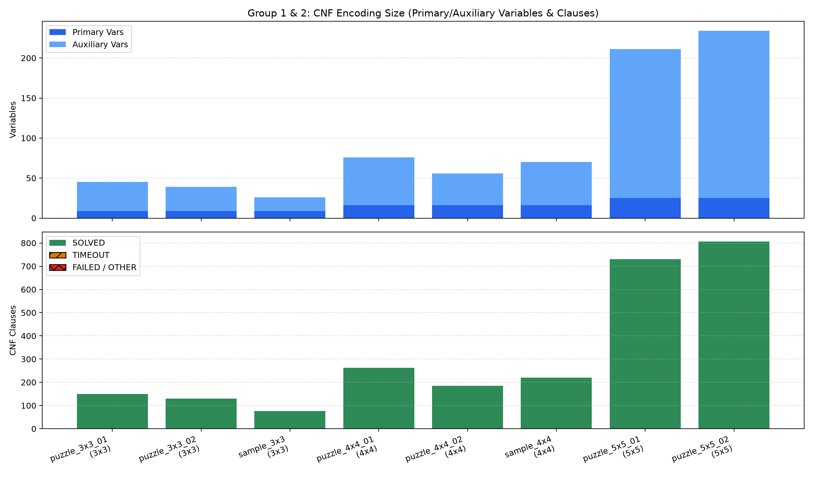
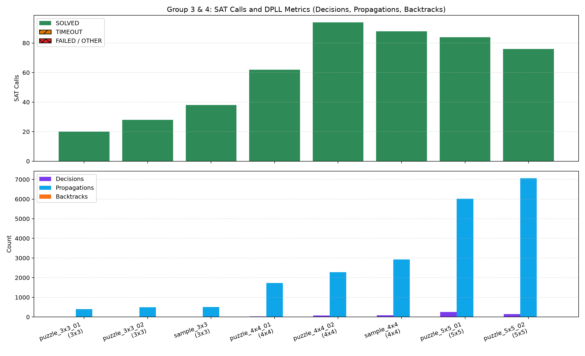
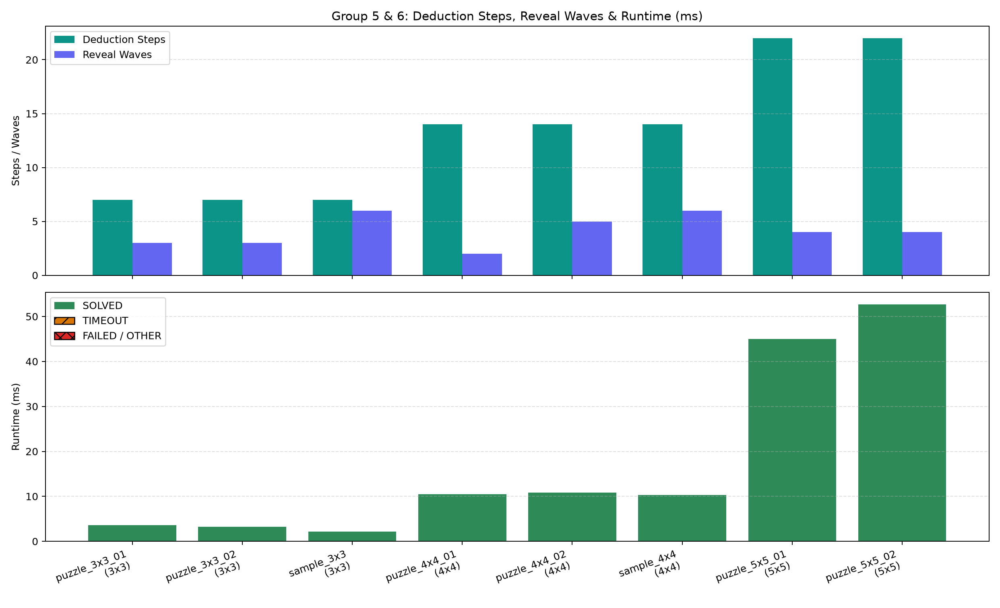
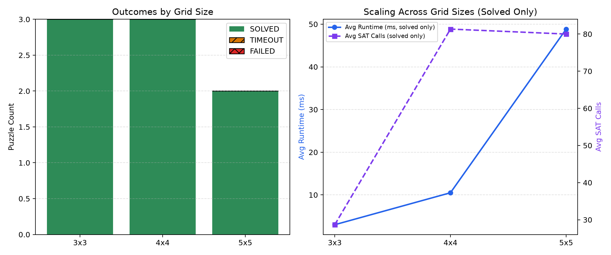
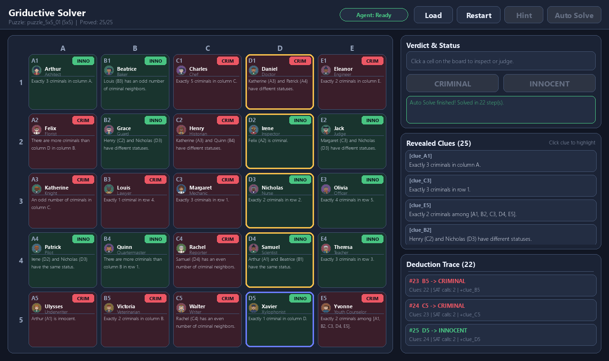

CSC14003 — Introduction to Artificial Intelligence: Project 2 — Griductive Solver

1. Lập kế hoạch dự án và Phân chia công việc (Project Planning and Task Distribution)

1.1. Tổng quan kế hoạch và Lộ trình thực hiện

Dự án được thực hiện bởi nhóm 5 sinh viên. Toàn bộ quá trình triển khai chia làm ba giai đoạn liên tiếp:

- **Giai đoạn 1 (18/11 – 22/11): Thiết kế kiến trúc và cài đặt các module độc lập.**
  - Ngày 19/11: Hoàn thiện `src/models.py`, xác định các cấu trúc dữ liệu dùng chung (`Puzzle`, `Clue`, `PublicState`, `CNFFormula`, `SolverResult`, `VerdictResponse`, `HintResponse`, `DeductionStep`) cùng hàm chuẩn hóa vùng `resolve_region()`.
  - Ngày 20/11: Xây dựng tập dữ liệu kiểm thử khói gồm 2 puzzle mẫu (`sample_3x3.json`, `sample_4x4.json`); hoàn thành bảng ánh xạ biến tất định và bộ kiểm tra tính hợp lệ của manh mối (`src/encoder.py`).
  - Ngày 21/11: Cài đặt và kiểm thử bộ giải DPLL SAT Solver thuần Python (`src/dpll.py`).
  - Ngày 22/11: Hoàn tất Game Engine, bộ thẩm định ngữ nghĩa trực tiếp (`src/game_engine.py`) và bộ mã hóa CNF tự động (`src/encoder.py`).

- **Giai đoạn 2 (23/11 – 25/11): Tích hợp tác tử logic, xây dựng dữ liệu benchmark và giao diện.**
  - Ngày 23/11: Cài đặt thuật toán phân loại hệ quả logic và hàm kiểm tra tính duy nhất của nghiệm (`check_uniqueness`) trong `src/agent.py`; dựng khung giao diện đồ họa GUI trong `src/main.py`.
  - Ngày 24/11: Hoàn thiện vòng lặp suy diễn không đoán, cơ chế sinh gợi ý và xuất vết suy diễn; thẩm định tập dữ liệu câu đố benchmark kích thước 3x3, 4x4 và 5x5 đảm bảo mỗi câu đố có nghiệm duy nhất.
  - Ngày 25/11: Tích hợp toàn diện giao diện với Game Engine và Agent; hỗ trợ thao tác gán phán quyết thủ công, tô sáng vùng manh mối và chế độ giải tự động; chạy kiểm thử tích hợp toàn hệ thống.

- **Giai đoạn 3 (26/11 – 28/11): Thực nghiệm, đánh giá và đóng gói.**
  - Ngày 26/11: Chạy benchmark tự động trên toàn bộ tập dữ liệu, xuất bảng số liệu 6 nhóm chỉ số ra tập tin CSV.
  - Ngày 27/11: Lập biểu đồ trực quan hóa dữ liệu thực nghiệm, hoàn thiện các phần nội dung của báo cáo kỹ thuật và ghi hình video minh họa chức năng hệ thống.
  - Ngày 28/11: Rà soát toàn bộ mã nguồn trên môi trường thực thi sạch, hoàn thiện tài liệu hướng dẫn và đóng gói nộp bài.

1.2. Kiến trúc hệ thống và Giao diện giữa các module

Hệ thống được tổ chức theo kiến trúc phân tầng rõ ràng, đặt toàn bộ mã nguồn thực thi bên trong thư mục `src/`. Các module giao tiếp với nhau thông qua hợp đồng dữ liệu tại `src/models.py`:

- **Lớp dữ liệu dùng chung (`src/models.py`):** Nơi định nghĩa duy nhất cho các dataclass trao đổi giữa các tầng và hàm `resolve_region()`. Việc tập trung logic phân giải tọa độ vùng (hàng, cột, lân cận, danh sách tường minh) tại một vị trí giúp loại bỏ nguy cơ lệch tọa độ giữa Game Engine, Encoder và giao diện hiển thị.
- **Tầng quản lý trò chơi (`src/game_engine.py`):** Lớp `GameEngine` nắm giữ câu đố gốc, trạng thái ẩn của nhân vật (`hidden_status`) và các manh mối chưa mở. Module thực hiện nguyên tắc ẩn giấu thông tin nghiêm ngặt: hàm `get_public_state()` chỉ xuất bản sao trạng thái công khai (`PublicState`) gồm các manh mối đã lật và phán quyết đã chứng minh. Hàm `evaluate_clue()` kiểm tra trực tiếp chân trị của manh mối trên một phép gán hoàn chỉnh mà không qua biểu diễn CNF, đóng vai trò nguồn kiểm chứng độc lập cho bộ mã hóa.
- **Tầng mã hóa logic (`src/encoder.py`):** Cung cấp các hàm ánh xạ biến tất định, kiểm tra ràng buộc tham số manh mối và chuyển đổi các mẫu manh mối sang dạng chuẩn hội CNF. Bộ mã hóa tổng hợp các manh mối đã mở và phán quyết đã biết thành cơ sở tri thức $KB_t$.
- **Tầng giải SAT (`src/dpll.py`):** Cài đặt thuật toán DPLL thuần Python, nhận công thức CNF và danh sách giả định tạm thời để kiểm tra tính thỏa được mà không thay đổi cấu trúc $KB_t$ gốc, đồng thời đo lường các chỉ số quyết định, lan truyền đơn vị, quay lui và thời gian tính toán.
- **Tầng tác tử suy diễn (`src/agent.py`):** Lớp `DeductiveLogicAgent` tiếp nhận `PublicState`, điều phối các truy vấn SAT qua bộ mã hóa và bộ giải DPLL để phân loại trạng thái logic của từng ô, thực hiện vòng lặp suy diễn không đoán, xuất vết suy diễn chi tiết và cung cấp gợi ý nước đi tiếp theo.
- **Tầng giao diện người dùng (`src/main.py`):** Cung cấp giao diện trực quan hiển thị lưới ô cờ, xử lý các thao tác tải câu đố, khởi động lại, nhận phán quyết từ người chơi, tô sáng các ô liên quan khi chọn manh mối và hiển thị tiến trình tự động giải.

Kiến trúc bảo đảm nguyên tắc ẩn giấu thông tin: Tác tử logic và giao diện người dùng không thể truy cập trạng thái bí mật hay các manh mối chưa mở. Khi người chơi gửi một phán quyết chưa đủ điều kiện chứng minh từ tri thức hiện tại, Game Engine từ chối phán quyết và giữ nguyên trạng thái bàn cờ.

1.3. Bảng phân công công việc và Tỷ lệ hoàn thành của từng thành viên

| Thành viên | Trách nhiệm chính | Sản phẩm bàn giao | Tỷ lệ hoàn thành |
| :--- | :--- | :--- | :---: |
| **Hào** | Quản lý schema dùng chung, Game Engine, Direct Semantic Evaluator, tập dữ liệu puzzle (3x3, 4x4, 5x5), đóng gói dự án. | `src/models.py`, `src/game_engine.py`, `src/puzzles/*.json`, mục 1 và 2 báo cáo, `README.md`. | 100% |
| **Tuân** | Ánh xạ biến tất định, bộ kiểm tra tính hợp lệ của manh mối, bộ mã hóa CNF tự động (6 mẫu cốt lõi và 2 mở rộng). | `src/encoder.py`, `src/tests/test_encoder.py`, mục 3 báo cáo. | 100% |
| **Bảo** | Bộ giải DPLL SAT Solver thuần Python, hỗ trợ giả định, ghi nhận metrics, xây dựng kịch bản benchmark tự động. | `src/dpll.py`, `src/tests/test_dpll.py`, `src/experiments/run_experiments.py`, mục 4.1 báo cáo. | 100% |
| **Tuấn** | Tác tử suy diễn logic, phân loại hệ quả logic, kiểm tra nghiệm duy nhất, vòng lặp suy diễn không đoán, tạo vết suy diễn và gợi ý. | `src/agent.py`, `src/tests/test_agent.py`, mục 4.2 đến 4.4 báo cáo. | 100% |
| **Khoa** | Giao diện đồ họa người dùng, tương tác bàn cờ, trực quan hóa manh mối, tổng hợp biểu đồ thực nghiệm, ghi hình video demo. | `src/main.py`, `src/experiments/plot_results.py`, mục 5 báo cáo, video demo minh họa. | 100% |

2. Phát biểu bài toán (Problem Formulation)

2.1. Biến mệnh đề (Propositional Variables)

Bàn cờ kích thước $N \times N$ gồm các ô tọa độ $(r, c)$, với hàng $r \in \{0, \ldots, N-1\}$ và cột $c \in \{0, \ldots, N-1\}$. Ký hiệu hiển thị quy ước cột theo chữ cái (A, B, C,...) và hàng theo số bắt đầu từ 1. Mỗi ô chứa một nhân vật có trạng thái danh tính ẩn thuộc tập $\{\text{CRIMINAL}, \text{INNOCENT}\}$.

Với mỗi nhân vật tại vị trí $i$, đặt một biến Boolean chính $C_i$:
- $C_i = \text{True}$: nhân vật tại ô $i$ là `CRIMINAL`.
- $C_i = \text{False}$: nhân vật tại ô $i$ là `INNOCENT`.

Ánh xạ biến chính được thiết lập tất định theo thứ tự quét hàng (row-major order): ô tại hàng $r$, cột $c$ nhận chỉ số định danh $v = r \cdot N + c + 1$. Tổng số biến chính của bàn cờ là $N^2$. Trong quá trình chuyển đổi các ràng buộc đếm hoặc ràng buộc mở rộng sang CNF, các biến phụ (auxiliary variables) được cấp phát chỉ số bắt đầu từ $N^2 + 1$. Các biến phụ này phục vụ mục đích biểu diễn logic ngưỡng và được tách biệt hoàn toàn khỏi tập biến chính, bảo đảm không làm biến dạng phép chiếu nghiệm trên các nhân vật của bài toán.

2.2. Ngôn ngữ manh mối cốt lõi và Phần mở rộng (Clue Language & Extensions)

Mỗi manh mối áp dụng trên một vùng ô $R \subseteq \{1, \ldots, N^2\}$. Hàm `resolve_region(region, size)` xác định tập các ô thuộc $R$ dựa trên 4 loại cấu trúc:
- `ROW`: Tập hợp tất cả các ô trên cùng một chỉ số hàng.
- `COL`: Tập hợp tất cả các ô trên cùng một chỉ số cột.
- `NEIGHBORS`: Tập hợp các ô kề cạnh hoặc kề góc với ô chỉ định (tối đa 8 ô lân cận, không chứa chính ô chỉ định).
- `EXPLICIT`: Danh sách các tọa độ ô được liệt kê cụ thể.

Sáu mẫu manh mối cốt lõi bao gồm:
- `FACT`: Xác định trực tiếp trạng thái của một nhân vật. Biểu diễn logic tương đương mệnh đề đơn $C_i$ (nếu `CRIMINAL`) hoặc $\neg C_i$ (nếu `INNOCENT`).
- `SAME`: Hai nhân vật có cùng trạng thái danh tính: $C_a \leftrightarrow C_b$.
- `DIFFERENT`: Hai nhân vật có trạng thái đối lập: $C_a \oplus C_b$.
- `EXACTLY`: Số lượng nhân vật `CRIMINAL` trong vùng $R$ bằng đúng $k$: $\sum_{i \in R} C_i = k$ (với $0 \le k \le |R|$).
- `AT_LEAST`: Số lượng nhân vật `CRIMINAL` trong vùng $R$ tối thiểu là $k$: $\sum_{i \in R} C_i \ge k$.
- `AT_MOST`: Số lượng nhân vật `CRIMINAL` trong vùng $R$ tối đa là $k$: $\sum_{i \in R} C_i \le k$.

Hai mẫu manh mối mở rộng được nhóm xây dựng thêm:
- `PARITY`: Tính chẵn lẻ của tổng số `CRIMINAL` trong vùng $R$:
  $$\bigoplus_{i \in R} C_i = \begin{cases} 1 & \text{khi manh mối là ODD} \\ 0 & \text{khi manh mối là EVEN} \end{cases}$$
- `COMPARE_COUNT`: So sánh tương quan số lượng `CRIMINAL` giữa hai vùng $R_1$ và $R_2$ qua toán tử $op \in \{\text{GT}, \text{LT}, \text{EQ}\}$:
  $$\sum_{i \in R_1} C_i > \sum_{j \in R_2} C_j \quad (\text{GT}), \quad \sum_{i \in R_1} C_i < \sum_{j \in R_2} C_j \quad (\text{LT}), \quad \sum_{i \in R_1} C_i = \sum_{j \in R_2} C_j \quad (\text{EQ})$$

2.3. Cơ sở tri thức (Knowledge Base)

Tại mỗi bước suy diễn $t$, cơ sở tri thức công khai $KB_t$ được xây dựng thuần túy từ thông tin đã được tiết lộ:
$$KB_t = \left( \bigwedge_{c \in \mathcal{C}_t} \text{CNF}(c) \right) \land \left( \bigwedge_{v \in \mathcal{V}_t} \text{unit}(v) \right)$$
trong đó $\mathcal{C}_t$ là tập hợp các manh mối đã lật mở, $\mathcal{V}_t$ là tập hợp các phán quyết đã được chứng minh hợp lệ, và $\text{unit}(v)$ là mệnh đề đơn biểu diễn phán quyết ($C_i$ nếu `CRIMINAL`, $\neg C_i$ nếu `INNOCENT`).

Cơ sở tri thức $KB_t$ tuân thủ các nguyên lý:
- Không đưa thông tin chưa lật hoặc trạng thái ẩn vào $KB_t$.
- Phân biệt giữa nghiệm thỏa mãn (satisfying model) và hệ quả logic (entailment): Một mô hình thỏa mãn chỉ là một khả năng gán giá trị hợp lệ cho các biến. Phán quyết về trạng thái của nhân vật $i$ chỉ được chấp nhận khi trạng thái đó đúng trong toàn bộ các mô hình của $KB_t$, tức $KB_t \models C_i$ hoặc $KB_t \models \neg C_i$.

2.4. Giao thức tiết lộ và Vòng lặp suy diễn (Reveal Protocol & Deduction Loop)

Việc kiểm tra hệ quả logic cho nhân vật $i$ tại bước $t$ được chuyển về bài toán kiểm tra tính thỏa được của công thức CNF bằng phương pháp phản chứng:
- $KB_t \models C_i \iff KB_t \land \neg C_i$ là UNSAT. Khi đó, nhân vật $i$ được chứng minh là `CRIMINAL`.
- $KB_t \models \neg C_i \iff KB_t \land C_i$ là UNSAT. Khi đó, nhân vật $i$ được chứng minh là `INNOCENT`.
- Nếu cả hai bài toán đều SAT, trạng thái của ô $i$ là `UNKNOWN`, chưa thể đưa ra kết luận logic từ $KB_t$.
- Nếu bản thân $KB_t$ là UNSAT, trạng thái là `INCONSISTENT`, chỉ ra cơ sở tri thức chứa mâu thuẫn.

Giao thức phản hồi phán quyết của trò chơi hoạt động như sau:
1. Khi người chơi hoặc tác tử gửi phán quyết cho ô $i$, hệ thống kiểm tra hệ quả logic từ $PublicState$.
2. Nếu phán quyết trùng với trạng thái bị bắt buộc (`ENTAILED`), phán quyết được chấp nhận. Thẻ tại ô $i$ được lật mở, manh mối mới được tiết lộ và cập nhật vào $KB_{t+1}$.
3. Nếu trạng thái ô $i$ là `UNKNOWN`, phán quyết bị từ chối với lý do `NOT_PROVABLE`. Trạng thái bàn cờ giữ nguyên, không lật thẻ và không để lộ thông tin manh mối ẩn.
4. Nếu trạng thái ô $i$ bị bắt buộc theo chiều ngược lại, phán quyết bị từ chối với lý do `CONTRADICTED`. Trạng thái bàn cờ giữ nguyên.

Vòng lặp suy diễn không đoán (No-Guess Deduction Loop) tự động hóa quá trình giải:
1. Bắt đầu tại $t = 0$ với các manh mối ban đầu được lật mở.
2. Duyệt qua các ô chưa giải theo thứ tự tất định (hàng trước, cột sau).
3. Với mỗi ô, kiểm tra hai truy vấn SAT tương ứng. Ngay khi phát hiện một ô có trạng thái bị bắt buộc, thực hiện phán quyết, lật thẻ ô đó, ghi nhận bước suy diễn (`DeductionStep`), cập nhật sang $KB_{t+1}$ và tiếp tục bước $t+1$.
4. Vòng lặp kết thúc thành công khi tất cả các ô được giải quyết. Nếu toàn bộ các ô chưa giải đều ở trạng thái `UNKNOWN`, bộ giải dừng lại và thông báo không thể giải tiếp mà không đoán.

3. Mã hóa CNF (CNF Encoding)

3.1. Ánh xạ biến tất định và Kiểm tra hợp lệ (Variable Mapping & Validation)

Mỗi ô trên lưới $N \times N$ có một biến chính, với giá trị `True` nếu nhân vật là `CRIMINAL`. ID được cấp từ 1 đến $N^2$ theo thứ tự hàng rồi cột. Các biến phụ bắt đầu từ $N^2+1$. Trước khi mã hóa, bộ kiểm tra xác thực tham số manh mối và dùng `resolve_region()` để xác định vùng. Với manh mối đếm, điều kiện hợp lệ là $0 \le k \le |R|$.

`encode_public_state()` ghép CNF của các manh mối đã mở với một mệnh đề đơn cho mỗi phán quyết đã chứng minh. `CNFFormula` ghi số biến chính, số biến phụ và số mệnh đề của cơ sở tri thức tại bước đó.

3.2. Phương pháp mã hóa lực lượng (Cardinality Encoding)

Với vùng gồm các biến $x_1,\ldots,x_m$, đặt $T_{i,j}$ là biến cho biết có ít nhất $j$ người `CRIMINAL` trong $i$ ô đầu. Khi xét thêm ô $i$, ta có $T_{i,j} \leftrightarrow T_{i-1,j} \lor (T_{i-1,j-1} \land x_i)$. Hai biên là $T_{i,0}=\mathrm{True}$ và $T_{i,j}=\mathrm{False}$ khi $j>i$.

`AT_LEAST(k)` đặt $T_{m,k}$ thành đúng, `AT_MOST(k)` đặt $T_{m,k+1}$ thành sai, còn `EXACTLY(k)` áp dụng cả hai cận. Cận đếm yêu cầu cả vùng cùng đúng hoặc cùng sai được mã hóa bằng các mệnh đề đơn. Nếu cần đến mức $\ell$, số mệnh đề cho bảng ngưỡng là $O(m\ell)$.

3.3. Suy dẫn manh mối hai ngôi (Binary Clue Derivation)

Với `SAME(A1, B1)`, gọi $a$ và $b$ là hai biến tương ứng. Điều kiện $a\leftrightarrow b$ tương đương $(a\Rightarrow b)\land(b\Rightarrow a)$. Thay mỗi phép kéo theo bằng phép tuyển, ta được $(\neg a\lor b)\land(a\lor\neg b)$.

3.4. Suy dẫn manh mối đếm (Counting Clue Derivation)

Xét `EXACTLY(2)` trên ba ô có biến $a,b,c$. Đặt $p\leftrightarrow(a\lor b)$ và $q\leftrightarrow(a\land b)$ cho hai ngưỡng trong hai ô đầu. Khi thêm $c$, ngưỡng ít nhất hai là $t\leftrightarrow(q\lor(p\land c))$, còn ngưỡng ít nhất ba là $u\leftrightarrow(q\land c)$.

Chiều $q\lor(p\land c)\Rightarrow t$ sinh hai mệnh đề $(\neg q\lor t)$ và $(\neg p\lor\neg c\lor t)$. Chiều ngược lại sinh $(\neg t\lor q\lor p)$ và $(\neg t\lor q\lor c)$. Mã hóa tương đương cho $p,q,u$ rồi thêm hai mệnh đề đơn $(t)$ và $(\neg u)$ để buộc đúng hai ô.

3.5. Mã hóa các phần mở rộng (Extensions Encoding)

- `PARITY` nối các phép XOR theo thứ tự ô trong vùng. Mỗi biến $z\leftrightarrow(a\oplus b)$ sinh bốn mệnh đề $(a\lor b\lor\neg z)$, $(\neg a\lor\neg b\lor\neg z)$, $(a\lor\neg b\lor z)$ và $(\neg a\lor b\lor z)$. Cố định kết quả cuối thành đúng cho `ODD` và sai cho `EVEN`.
- `COMPARE_COUNT` tạo hai dãy biến ngưỡng $L_j$ và $R_j$. Với `GT`, thêm $(L_1)$ và các mệnh đề $(\neg R_j\lor L_{j+1})$. Nếu $j+1$ vượt kích thước vùng trái, mệnh đề còn lại là $(\neg R_j)$. `LT` đổi vai trò hai vùng. `EQ` buộc hai vùng đạt cùng ngưỡng bằng hai chiều $L_j\leftrightarrow R_j$, với ngưỡng vượt kích thước vùng được xem là sai.

4. Thuật toán (Algorithms)

4.1. Bộ giải DPLL SAT Solver

Bộ giải được cài đặt bằng Python thuần trong `src/dpll.py`, không dùng thư viện SAT/CSP bên ngoài. Đầu vào là một `CNFFormula` (hoặc danh sách mệnh đề `list[list[int]]`) cùng danh sách giả định (assumptions) tùy chọn. Đầu ra là `SolverResult` gồm `status` (`SAT`/`UNSAT`), `assignment` (phép gán hoàn chỉnh khi SAT) và bốn chỉ số `decisions`, `propagations`, `backtracks`, `runtime_ms`.

**Tiền xử lý.** Lớp `DPLLSolver` chuẩn hóa công thức một lần khi khởi tạo. Literal phải là số nguyên khác 0. Literal lặp trong cùng mệnh đề bị loại, mệnh đề hằng đúng (chứa cả $x$ và $\neg x$) bị bỏ qua, và mệnh đề rỗng được đánh dấu để trả về UNSAT ngay. Bộ giải lập danh sách xuất hiện (occurrence list) cho từng literal, tức danh sách các mệnh đề chứa literal đó. Số biến lấy giá trị lớn nhất giữa `num_primary_vars + num_aux_vars` và ID biến lớn nhất xuất hiện trong mệnh đề, nên phép gán trả về luôn phủ đủ biến chính $C_i$ lẫn biến phụ.

**Mã giả.**

```
function SOLVE(F, assumptions):
    if F chứa mệnh đề rỗng: return UNSAT
    for ℓ in assumptions, rồi các mệnh đề đơn của F:      // mức quyết định 0
        if ENQUEUE(ℓ) gặp xung đột: return UNSAT           // propagations += 1
    return DPLL() ? (SAT, phép gán) : UNSAT

function DPLL():
    if not UNIT_PROPAGATE(): return false                  // phát hiện xung đột
    x ← biến chưa gán có ID nhỏ nhất xuất hiện trong F     // chọn biến tất định
    if x = none: return true                               // mọi mệnh đề đã thỏa
    for ℓ in [x, ¬x]:                                      // thử True trước, False sau
        decisions += 1; mark ← |trail|; gán ℓ
        if DPLL(): return true
        hoàn tác trail về mark; backtracks += 1           // quay lui
    return false

function UNIT_PROPAGATE():
    while còn literal ℓ trên trail chưa xử lý:
        for mỗi mệnh đề c chứa ¬ℓ:
            if c đã thỏa: continue
            if c không còn literal chưa gán: return false  // xung đột
            if c còn đúng một literal u chưa gán:
                gán u; propagations += 1
    return true
```

**Lan truyền đơn vị (unit propagation).** Mọi literal được gán đều đẩy vào ngăn xếp `trail`, và con trỏ `queue_head` đánh dấu literal kế tiếp cần xử lý. Khi literal $\ell$ thành đúng, chỉ các mệnh đề chứa $\neg\ell$ mới có thể trở thành mệnh đề đơn hoặc mệnh đề rỗng, nên bộ giải chỉ duyệt danh sách xuất hiện của $\neg\ell$. Với mỗi mệnh đề, bộ giải đếm số literal chưa gán và dừng sớm khi gặp literal đúng hoặc khi đã thấy hai literal chưa gán. Nếu còn đúng một literal chưa gán thì literal đó bị buộc phải đúng.

**Phát hiện xung đột (conflict detection).** Xung đột xảy ra khi một mệnh đề có toàn bộ literal sai, hoặc khi một literal cần gán ngược với giá trị đã có (ví dụ hai giả định $C_i$ và $\neg C_i$, hay hai mệnh đề đơn $(x)$ và $(\neg x)$). Khi đó nhánh hiện tại thất bại ngay. Nếu xung đột xảy ra ở mức 0 (trước mọi quyết định) thì công thức là UNSAT mà không cần phân nhánh.

**Chọn biến tất định và phân nhánh đệ quy.** Biến phân nhánh là biến chưa gán có ID nhỏ nhất trong các biến xuất hiện ở công thức. Vì encoder đánh số biến chính $C_i$ từ $1$ đến $N^2$ theo thứ tự hàng rồi cột, bộ giải luôn phân nhánh trên các nhân vật trước các biến phụ. Mỗi biến được thử giá trị True trước rồi mới đến False. Bộ giải không dùng yếu tố ngẫu nhiên và không phụ thuộc thứ tự duyệt của `set`. Vì vậy, với cùng công thức và cùng danh sách giả định, các lần giải hoàn tất cho cùng kết quả, cùng phép gán và cùng ba chỉ số `decisions`, `propagations`, `backtracks`. Riêng `runtime_ms` là thời gian đo thực tế nên dao động theo máy và tải hệ thống. Pure-literal elimination và heuristic nâng cao không được cài đặt vì đề bài để tùy chọn.

**Quay lui (backtracking).** Trước mỗi quyết định, bộ giải lưu `mark = |trail|`. Nếu nhánh thất bại, mọi literal sau `mark` (gồm literal quyết định và các literal lan truyền theo nó) được trả về trạng thái chưa gán, `queue_head` được đặt lại bằng `mark`, rồi nhánh ngược lại được thử. Đây là quay lui theo thứ tự thời gian (chronological backtracking). Độ sâu đệ quy tối đa bằng số biến phân nhánh, nên bộ giải tạm nâng `sys.setrecursionlimit` khi KB lớn.

**Giả định (assumptions) và tính độc lập giữa các truy vấn.** Để kiểm tra $KB_t \land \neg C_i$ và $KB_t \land C_i$, Logic Agent tạo một `DPLLSolver(KB_t)` rồi gọi `solve([-v])` và `solve([+v])`. Giả định được gán ở mức 0 và tương đương về logic với một mệnh đề đơn tạm thời: `solve(F, [ℓ])` cho cùng kết quả, cùng phép gán, cùng `decisions` và `backtracks` như giải $F \land (\ell)$. Riêng `propagations` có thể lệch. Giả định được gán trước các mệnh đề đơn gốc của $F$, và khi một nhánh gặp xung đột, số literal đã gán trước lúc phát hiện xung đột phụ thuộc vào thứ tự đó. Chẳng hạn, `solve([[1],[-1]], [2])` đếm 2 propagations, còn `solve([[1],[-1],[2]])` chỉ đếm 1; cả hai đều UNSAT. Trên $KB_0$ của 8 puzzle, 28 trong 214 truy vấn bị lệch theo cách này, và đều là truy vấn UNSAT. Mỗi lần gọi `solve` tạo trạng thái tìm kiếm mới (mảng giá trị, trail, bộ đếm), còn mệnh đề và danh sách xuất hiện chỉ được đọc. Nhờ vậy `CNFFormula` gốc không bị sửa và các truy vấn liên tiếp trên cùng $KB_t$ không rò rỉ trạng thái cho nhau. Ví dụ ở Mục 3.4 với $KB = (C_A \lor C_B) \land (\neg C_A \lor C_B)$: `solve([-B])` trả về UNSAT nên $KB \models C_B$, còn `solve([A])` và `solve([-A])` đều SAT nên A là UNKNOWN.

**Cách đếm metrics.**

- `decisions`: số lần gán một literal do phân nhánh, tính cả nhánh True và nhánh False của cùng một biến.
- `propagations`: số literal được gán không phải do quyết định, gồm giả định, mệnh đề đơn ban đầu và literal bị buộc trong lúc lan truyền.
- `backtracks`: số lần một nhánh quyết định thất bại và bị hoàn tác.
- `runtime_ms`: thời gian thực của một lần gọi `solve`, đo bằng `time.perf_counter()` và đổi sang mili giây.

Ba chỉ số đếm là số nguyên không âm, còn `runtime_ms` là số thực không âm tính bằng mili giây. Mọi chỉ số được tính riêng cho từng lần gọi `solve`, không cộng dồn giữa các lần gọi. Ví dụ với $F = (\neg x_1 \lor x_2)(\neg x_1 \lor x_3)(\neg x_2 \lor \neg x_3)(x_1 \lor x_4)$:

1. Quyết định $x_1=$ True lan truyền $x_2, x_3$ và gây xung đột ở $(\neg x_2 \lor \neg x_3)$, nên bộ giải quay lui.
2. Quyết định $x_1=$ False lan truyền $x_4$.
3. Quyết định $x_2=$ True lan truyền $\neg x_3$.

Kết quả là SAT với 3 decisions, 4 propagations và 1 backtrack.

**Giới hạn thời gian.** Tham số tùy chọn `time_limit_ms` là một giới hạn mềm. Deadline chỉ được kiểm tra ở đầu mỗi lời gọi đệ quy `DPLL()`, không kiểm tra trong lúc lan truyền đơn vị, nên lời gọi có thể chạy quá ngân sách một đoạn trước khi dừng; độ vượt phụ thuộc vào lượng lan truyền ở nút đang xử lý. Khi phát hiện quá hạn, bộ giải ném `SolverTimeout` kèm `partial` chứa các chỉ số đã thu được. Trường `status` của `partial` được đặt là `TIMEOUT`: lượt tìm kiếm bị ngắt giữa chừng không chứng minh công thức là SAT hay UNSAT. Kết quả bán phần chỉ dùng để thống kê, giúp script thực nghiệm ghi nhận ca quá thời gian thay vì loại bỏ nó (Mục 5). Ở cấp Logic Agent, ngân sách tính cho cả lượt giải và mỗi truy vấn DPLL nhận phần thời gian còn lại; riêng bước Game Engine kiểm tra lại phán quyết trong `submit_verdict` không nhận ngân sách này, nên script thực nghiệm dùng thêm hard timeout ở cấp tiến trình con.

**Kiểm thử.** `src/tests/test_dpll.py` có 250 test, kiểm tra các nhóm sau:

- Các ca SAT, UNSAT, công thức rỗng, mệnh đề rỗng, chuỗi đơn vị, xung đột sớm, mệnh đề hằng đúng và bài toán chuồng bồ câu PHP(4,3).
- So khớp với bộ liệt kê vét cạn (brute-force oracle) trên 200 công thức CNF ngẫu nhiên có seed cố định.
- Tính tất định khi chạy lặp lại.
- Tính độc lập của giả định, và sự tương đương giữa giả định với mệnh đề đơn tạm thời: cùng kết quả, phép gán, decisions và backtracks trên $KB_0$ của cả 8 puzzle; propagations được phép lệch.
- Giá trị metrics chính xác và cơ chế timeout (`partial.status` là `TIMEOUT`).
- Tích hợp với encoder và game engine trên `sample_3x3` và `sample_4x4`: nghiệm DPLL thỏa `evaluate_puzzle` (bộ đánh giá ngữ nghĩa độc lập với CNF), blocking clause cho UNSAT (nghiệm duy nhất), và mọi phán quyết bị buộc trên $KB_0$ khớp với lời giải ẩn.

**Hạn chế.** DPLL cơ bản không học mệnh đề (no clause learning) và quay lui theo thứ tự thời gian, nên trong trường hợp xấu nhất thời gian chạy tăng theo hàm mũ. Để đo mức ảnh hưởng, nhóm chạy `src/experiments/random_3sat.py` trên 3-SAT ngẫu nhiên 150 biến, 630 mệnh đề (tỉ lệ mệnh đề/biến 4,2, gần ngưỡng chuyển pha), với seed 0–4, trên Python 3.11, Windows 11 và CPU Intel Core thế hệ 12. Kết quả gồm 4 công thức SAT và 1 công thức UNSAT; thời gian giải từ 0,6 đến 98,3 giây, trung vị 48,8 giây. Công thức UNSAT chậm nhất, cần gần 5 triệu decisions, vì bộ giải phải duyệt hết cây tìm kiếm mới kết luận được. Mức chênh hơn 150 lần giữa các seed cho thấy thời gian trên công thức ngẫu nhiên khó phụ thuộc mạnh vào từng thể hiện. Dữ liệu được lưu tại `random_3sat_results.csv`. Ngược lại, KB của Griductive có cấu trúc chặt và phần lớn được giải bằng lan truyền, nên giới hạn này ít ảnh hưởng ở kích thước 3×3–5×5 (Mục 5).

Tái lập:

```bash
python src/experiments/random_3sat.py --vars 150 --ratio 4.2 --seeds 0 1 2 3 4 --hard-timeout 600
```

4.2. Phân loại hệ quả logic (Entailment Classification)

4.3. Kiểm tra tính duy nhất (Uniqueness Checking)

4.4. Vòng lặp suy diễn không đoán và Cơ chế gợi ý (No-Guess Deduction Loop & Hint)

5. Thực nghiệm (Experiments)

5.1. Thiết lập thực nghiệm và Tập dữ liệu Puzzle (3×3, 4×4, 5×5)

**Môi trường và quy trình đo đạc.** Toàn bộ thực nghiệm được chạy tự động bằng kịch bản `src/experiments/run_experiments.py` trên cùng một tập dữ liệu câu đố cho mọi phép so sánh, sau đó tổng hợp bảng và vẽ biểu đồ bằng `src/experiments/plot_results.py` (xuất kết quả vào thư mục `assets/`). Mỗi câu đố được thực thi thông qua đầy đủ dây chuyền `GameEngine` $\rightarrow$ `CNF Encoder` $\rightarrow$ `DPLLSolver` $\rightarrow$ `LogicAgent` với cấu hình:

- **Lặp đo thời gian (`repeats = 3`):** mỗi puzzle được giải độc lập 3 lần; giá trị `runtime_ms` báo cáo là **trung vị (median)** của 3 lần chạy (kèm `runtime_ms_min` và `runtime_ms_max`), đồng thời kiểm tra chéo tính tất định của chữ ký suy diễn (`status`, `steps`, `sat_calls`, `decisions`, `propagations`, `backtracks`, chuỗi tọa độ và phán quyết) giữa các lần lặp.
- **Cơ chế bảo vệ quá thời gian hai lớp (Timeout Guard):**
  1. *Giới hạn mềm (`--time-limit-ms 60000`):* `LogicAgent.solve_puzzle(time_limit_ms=60000)` theo dõi ngân sách thời gian còn lại cho từng truy vấn DPLL; nếu vượt ngưỡng, bộ giải dừng và trả về trạng thái `TIMEOUT` cùng các chỉ số bán phần đã thu được.
  2. *Giới hạn cứng (`--hard-timeout 180` giây):* mỗi puzzle chạy trong một tiến trình con cô lập (`multiprocessing` với ngữ cảnh `spawn`); nếu tiến trình vượt quá giới hạn tường thực, tiến trình bị ngắt và một dòng `TIMEOUT` vẫn được ghi nhận vào `benchmark_results.csv`.
- **Định nghĩa nhất quán 6 nhóm chỉ số:**
  1. *Biến chính và biến phụ:* `num_primary_vars` $= N^2$; `num_aux_vars` đo tại cơ sở tri thức $KB_t$ lớn nhất mà tác tử truy vấn (tức $KB$ ở bước quét cuối cùng trước khi giải xong hoặc khi dừng).
  2. *Số mệnh đề CNF:* `num_clauses` của $KB_t$ lớn nhất (bao gồm cả các mệnh đề đơn của phán quyết đã chứng minh $\mathcal{V}_t$), ghi nhận kèm `initial_clauses` (tại $KB_0$) và `full_kb_clauses` (toàn bộ manh mối dùng khi kiểm tra tính duy nhất).
  3. *Số lần gọi SAT (`sat_calls`):* tổng số truy vấn `DPLLSolver.solve` do `LogicAgent` thực hiện trong vòng lặp suy diễn (không tính các lần kiểm tra lại độc lập bên trong `GameEngine.submit_verdict`).
  4. *Chỉ số tìm kiếm DPLL:* tổng `decisions`, `propagations`, `backtracks` tích lũy trên các truy vấn SAT của tác tử.
  5. *Tiến trình suy diễn:* `deduction_steps` (số phán quyết bị bắt buộc được chấp nhận theo thứ tự row-major) và `reveal_waves` (số đợt tiết lộ song song khi lật đồng thời tất cả các ô bị bắt buộc ở mỗi vòng trên một bàn chơi độc lập).
  6. *Thời gian chạy (`runtime_ms`):* trung vị thời gian suy diễn toàn bàn (mili giây) đo bằng `time.perf_counter()`.

**Tập dữ liệu Puzzle kiểm thử.** Tập benchmark đặt tại `src/puzzles/` gồm **8 câu đố** trải đều ba kích thước (3×3, 4×4 và stress case 5×5), bao phủ đầy đủ 6 mẫu manh mối cốt lõi (`FACT`, `SAME`, `DIFFERENT`, `EXACTLY`, `AT_LEAST`, `AT_MOST`), 2 phần mở rộng (`PARITY`, `COMPARE_COUNT`) và 4 loại vùng (`ROW`, `COL`, `NEIGHBORS`, `EXPLICIT`). Toàn bộ 8 câu đố đều vượt qua kiểm tra `check_uniqueness() == "UNIQUE"` và được xác thực độc lập bằng `evaluate_puzzle()` trên lời giải gốc.

| Puzzle | Kích thước | Thẻ mở đầu (`initial_revealed`) | Phân bố mẫu manh mối (Clue Types) | Phân bố vùng (Regions) | Nghiệm duy nhất |
| :--- | :---: | :---: | :--- | :--- | :---: |
| `sample_3x3` | 3×3 | 2 | `EXACTLY`(4), `FACT`(1), `SAME`(1), `DIFFERENT`(1), `AT_LEAST`(1), `AT_MOST`(1) | `COL`(3), `ROW`(1), `NEIGHBORS`(1), `EXPLICIT`(1) | `UNIQUE` |
| `puzzle_3x3_01` | 3×3 | 2 | `COMPARE_COUNT`(3), `EXACTLY`(2), `DIFFERENT`(2), `PARITY`(2) | `ROW`(5), `COL`(2), `NEIGHBORS`(2), `EXPLICIT`(1) | `UNIQUE` |
| `puzzle_3x3_02` | 3×3 | 2 | `COMPARE_COUNT`(3), `PARITY`(2), `EXACTLY`(1), `AT_LEAST`(1), `AT_MOST`(1), `DIFFERENT`(1) | `COL`(7), `ROW`(2), `NEIGHBORS`(2) | `UNIQUE` |
| `sample_4x4` | 4×4 | 2 | `EXACTLY`(7), `FACT`(3), `SAME`(2), `DIFFERENT`(2), `AT_LEAST`(1), `AT_MOST`(1) | `ROW`(4), `COL`(3), `NEIGHBORS`(1), `EXPLICIT`(1) | `UNIQUE` |
| `puzzle_4x4_01` | 4×4 | 2 | `EXACTLY`(4), `SAME`(4), `DIFFERENT`(3), `COMPARE_COUNT`(2), `PARITY`(2), `FACT`(1) | `COL`(5), `NEIGHBORS`(3), `ROW`(2) | `UNIQUE` |
| `puzzle_4x4_02` | 4×4 | 2 | `SAME`(4), `DIFFERENT`(4), `EXACTLY`(3), `FACT`(1), `AT_LEAST`(1), `AT_MOST`(1), `PARITY`(1), `COMPARE_COUNT`(1) | `COL`(3), `NEIGHBORS`(3), `ROW`(2) | `UNIQUE` |
| `puzzle_5x5_01` | 5×5 | 3 | `EXACTLY`(11), `PARITY`(4), `DIFFERENT`(4), `COMPARE_COUNT`(2), `FACT`(2), `SAME`(2) | `COL`(9), `ROW`(6), `NEIGHBORS`(3), `EXPLICIT`(1) | `UNIQUE` |
| `puzzle_5x5_02` | 5×5 | 3 | `EXACTLY`(12), `DIFFERENT`(5), `PARITY`(3), `COMPARE_COUNT`(2), `AT_MOST`(2), `SAME`(1) | `COL`(9), `ROW`(7), `NEIGHBORS`(5) | `UNIQUE` |

5.2. Bảng tổng hợp kết quả theo 6 nhóm chỉ số

Kết quả chi tiết từ `benchmark_results.csv` (được tổng hợp tự động tại `assets/benchmark_summary.md`) cho từng puzzle và trung bình theo kích thước lưới được trình bày ở hai bảng dưới đây. Toàn bộ 8/8 câu đố đều đạt `status = SOLVED` và `solution_verified = True` (không phát sinh `TIMEOUT` hay `FAILED`).

**Bảng 5.1: Kết quả chi tiết theo từng puzzle (đủ 6 nhóm chỉ số)**

| Puzzle | Size | Status | Primary Vars | Aux Vars | Clauses ($KB_t$ max / $KB_0$ / Full) | SAT Calls | Decisions | Propagations | Backtracks | Steps | Waves | Runtime ms (Median [Min–Max]) |
| :--- | :---: | :---: | ---: | ---: | :---: | ---: | ---: | ---: | ---: | ---: | ---: | :---: |
| `puzzle_3x3_01` | 3×3 | `SOLVED` | 9 | 36 | 149 / 41 / 170 | 20 | 10 | 403 | 0 | 7 | 3 | 3.63 [3.34–3.89] |
| `puzzle_3x3_02` | 3×3 | `SOLVED` | 9 | 30 | 130 / 41 / 160 | 28 | 18 | 494 | 0 | 7 | 3 | 3.24 [2.98–3.36] |
| `sample_3x3` | 3×3 | `SOLVED` | 9 | 17 | 77 / 18 / 116 | 38 | 12 | 503 | 0 | 7 | 6 | 2.17 [2.15–2.57] |
| `puzzle_4x4_01` | 4×4 | `SOLVED` | 16 | 60 | 262 / 12 / 249 | 62 | 26 | 1,732 | 0 | 14 | 2 | 10.44 [9.98–11.37] |
| `puzzle_4x4_02` | 4×4 | `SOLVED` | 16 | 40 | 185 / 28 / 172 | 94 | 79 | 2,284 | 0 | 14 | 5 | 10.80 [10.42–10.93] |
| `sample_4x4` | 4×4 | `SOLVED` | 16 | 54 | 220 / 21 / 227 | 88 | 89 | 2,932 | 0 | 14 | 6 | 10.27 [9.69–10.88] |
| `puzzle_5x5_01` | 5×5 | `SOLVED` | 25 | 186 | 731 / 137 / 736 | 84 | 253 | 6,014 | 3 | 22 | 4 | 44.97 [43.73–45.36] |
| `puzzle_5x5_02` | 5×5 | `SOLVED` | 25 | 209 | 807 / 27 / 823 | 76 | 147 | 7,067 | 1 | 22 | 4 | 52.73 [52.09–54.40] |

**Bảng 5.2: Tổng hợp trung bình theo kích thước lưới (trung bình chỉ tính trên nhóm `SOLVED`)**

| Kích thước | Tổng | Solved | Timeout | Failed | TB Primary | TB Aux | TB Clauses | TB SAT Calls | TB Decisions | TB Propagations | TB Backtracks | TB Steps | TB Waves | TB Runtime (ms) |
| :---: | ---: | ---: | ---: | ---: | ---: | ---: | ---: | ---: | ---: | ---: | ---: | ---: | ---: | ---: |
| **3×3** | 3 | 3 | 0 | 0 | 9.0 | 27.7 | 118.7 | 28.7 | 13.3 | 466.7 | 0.0 | 7.0 | 4.0 | 3.01 |
| **4×4** | 3 | 3 | 0 | 0 | 16.0 | 51.3 | 222.3 | 81.3 | 64.7 | 2,316.0 | 0.0 | 14.0 | 4.3 | 10.50 |
| **5×5** | 2 | 2 | 0 | 0 | 25.0 | 197.5 | 769.0 | 80.0 | 200.0 | 6,540.5 | 2.0 | 22.0 | 4.0 | 48.85 |

5.3. Biểu đồ và Phân tích kết quả

Bốn biểu đồ dưới đây được sinh tự động từ `benchmark_results.csv` bằng `src/experiments/plot_results.py` và lưu tại thư mục `assets/`:









Từ số liệu ở Bảng 5.1–5.2 và bốn biểu đồ trên, nhóm rút ra các nhận xét trọng tâm sau:

1. **Quy mô mã hóa CNF tăng mạnh ở 5×5 và phụ thuộc rõ rệt vào loại manh mối (Biểu đồ 1):**
   - Trong khi biến chính tăng đúng theo $N^2$ (`9` $\rightarrow$ `16` $\rightarrow$ `25`), số biến phụ tăng gấp **3.85 lần** từ 4×4 lên 5×5 (từ trung bình `51.3` lên `197.5`) và số mệnh đề tăng gấp **3.46 lần** (từ `222.3` lên `769.0`). Tại `puzzle_5x5_02`, số biến phụ (`209`) lớn gấp **8.36 lần** số biến chính (`25`), tạo ra `807` mệnh đề ở $KB_t$ lớn nhất (tăng gần 30 lần so với `27` mệnh đề ở $KB_0$).
   - Nguyên nhân trực tiếp là độ phức tạp $O(m \cdot \ell)$ của bộ đếm tuần tự (sequential counter) cho `EXACTLY`/`AT_MOST`/`COMPARE_COUNT` và chuỗi biến trung gian XOR cho `PARITY`: ở lưới 5×5, mỗi vùng hàng/cột có $m = 5$ ô và vùng `NEIGHBORS` của ô bên trong lên tới $m = 8$ ô (`puzzle_5x5_02` có tới 12 `EXACTLY`, 2 `AT_MOST`, 2 `COMPARE_COUNT`, 3 `PARITY` và 5 vùng `NEIGHBORS`). Điều này cũng thấy rõ ngay trên cùng kích thước 3×3: `sample_3x3` (chỉ gồm 6 mẫu cốt lõi) chỉ cần `17` biến phụ và `77` mệnh đề, trong khi `puzzle_3x3_01` (có 3 `COMPARE_COUNT` và 2 `PARITY`) cần `36` biến phụ và `149` mệnh đề (gần gấp đôi).
   - Ở `puzzle_4x4_01` và `puzzle_4x4_02`, `num_clauses` ở $KB_t$ lớn nhất (`262` và `185`) cao hơn nhẹ so với `full_kb_clauses` (`249` và `172`) do $KB_t$ cộng thêm các mệnh đề đơn của những phán quyết đã chứng minh $\mathcal{V}_t$, còn `full_kb_clauses` chỉ mã hóa tập manh mối phục vụ kiểm tra nghiệm duy nhất.

2. **Lan truyền đơn vị (Unit Propagation) giải quyết phần lớn bài toán; quay lui rất thấp (Biểu đồ 2):**
   - Trên cả 6 puzzle 3×3 và 4×4, DPLL đạt **0 backtracks** dù phải thực hiện trung bình `466.7` đến `2,316.0` propagations. Chỉ khi chuyển sang stress case 5×5, sự tương tác chéo giữa nhiều manh mối đếm/chẵn lẻ mới làm xuất hiện quay lui nhẹ (`3` lần ở `puzzle_5x5_01` và `1` lần ở `puzzle_5x5_02`).
   - Tỉ lệ `Propagations / Decisions` duy trì ổn định rất cao ở mức **32.7:1 đến 35.8:1** trên cả ba kích thước lưới (vì vậy trên Biểu đồ 2 ở thang tuyến tính, cột `Backtracks` gần như sát trục hoành trong khi cột `Propagations` chiếm ưu thế áp đảo). Kết quả này khẳng định cơ sở tri thức của Griductive có cấu trúc ràng buộc chặt, phát huy tối đa hiệu quả của lan truyền đơn vị theo danh sách xuất hiện (occurrence list).

3. **Số lần gọi SAT phụ thuộc vào cấu trúc lan truyền và thứ tự quét row-major, không tăng đơn điệu theo $N$ (Biểu đồ 2 & 4):**
   - Trung bình `sat_calls` tăng mạnh từ `28.7` (3×3) lên `81.3` (4×4), nhưng ở 5×5 lại giữ ngang mức **`80.0`** (`84` và `76`), thậm chí thấp hơn đỉnh `94` của `puzzle_4x4_02`.
   - Lý do là vòng lặp suy diễn quét các ô chưa giải theo thứ tự hàng–cột và dừng ngay khi gặp ô bị bắt buộc đầu tiên (mỗi ô quét tốn 2 truy vấn SAT). Trên `puzzle_5x5_02`, trung bình mỗi bước chỉ cần quét khoảng `1.73` ô (`76 / 22 = 3.45` SAT calls/bước) là đã tìm được phán quyết bị bắt buộc; ngược lại, trên `puzzle_4x4_02`, các ô bị bắt buộc thường nằm về phía sau trong thứ tự row-major nên phải quét trung bình `3.36` ô/bước (`94 / 14 = 6.71` SAT calls/bước).

4. **Phân biệt rõ độ dài bước suy diễn (`deduction_steps`) và độ sâu logic (`reveal_waves`) (Biểu đồ 3):**
   - Vì mọi câu đố đều giải trọn vẹn không đoán, số bước luôn bằng đúng số ô úp ban đầu: $N^2 - |\text{initial\_revealed}|$ (`7` bước cho 3×3, `14` bước cho 4×4, `22` bước cho 5×5).
   - Ngược lại, `reveal_waves` phản ánh *độ sâu chuỗi phụ thuộc manh mối*: `puzzle_4x4_01` chỉ cần **2 đợt** (trung bình 7 ô bị bắt buộc mỗi đợt), hai màn 5×5 cần **4 đợt** (trung bình 5.5 ô/đợt), trong khi `sample_3x3` và `sample_4x4` cần tới **6 đợt** do các manh mối nối đuôi nhau tuần tự hơn.

5. **Tăng trưởng thời gian chạy ở 5×5 chủ yếu đến từ chi phí mỗi truy vấn SAT (Biểu đồ 3 & 4):**
   - Thời gian chạy trung bình tăng từ `3.01 ms` (3×3) lên `10.50 ms` (4×4, gấp **3.49×**) và vọt lên `48.85 ms` ở 5×5 (gấp **4.65×** so với 4×4 và **16.2×** so với 3×3; cao nhất là `puzzle_5x5_02` với `52.73 ms`).
   - Dù tổng `sat_calls` của 5×5 (`80.0`) tương đương 4×4 (`81.3`), **chi phí trung bình mỗi lần gọi SAT tăng gần 4.7 lần** (từ $\approx 0.13\text{ ms/call}$ ở 4×4 lên $\approx 0.61\text{ ms/call}$ ở 5×5). Nguyên nhân là sự kết hợp của kích thước công thức CNF lớn hơn gấp 3.5 lần (`769` vs `222` mệnh đề), số biến phụ lớn hơn gần 4 lần, lượng `propagations` tăng gần 3 lần (`6,540.5` vs `2,316.0`), và việc mã hóa lại $KB_t$ qua 22 bước liên tiếp.
   - Dù vậy, toàn bộ các màn 3×3–5×5 đều hoàn tất dưới **55 ms** (nhỏ hơn hơn 1,000 lần so với giới hạn mềm 60,000 ms), đảm bảo trải nghiệm tức thời trên giao diện GUI Pygame khi người chơi bấm xác nhận phán quyết, `Hint` hoặc `Auto Solve`.

5.4. Các trường hợp thất bại, quá thời gian và Hạn chế (Failures, Timeouts & Limitations)

**Báo cáo ca thất bại và quá thời gian.** Trên tập benchmark 8 câu đố chính thức (`benchmark_results.csv`), tỷ lệ giải thành công là **8/8 (100%)**, ghi nhận **0 ca `TIMEOUT`**, **0 ca `FAILED`**, **0 ca `UNKNOWN`** và **0 ca `INCONSISTENT`**. Các lần chạy lặp lại đều cho chữ ký suy diễn đồng nhất và lời giải khớp 100% với bộ đánh giá ngữ nghĩa trực tiếp.

Để tuân thủ chặt chẽ nguyên tắc *báo cáo thay vì loại bỏ các ca thất bại/quá thời gian*, toàn bộ pipeline thực nghiệm được thiết kế và kiểm thử đơn vị chuyên biệt cho các kịch bản lỗi:

- Trong `src/experiments/run_experiments.py` và `src/tests/test_run_experiments.py`: đã kiểm thử cả giới hạn mềm (`test_soft_timeout_row_is_kept`), giới hạn cứng ngắt tiến trình con (`test_hard_timeout_kills_worker`) và câu đố lỗi định dạng (`test_invalid_puzzle_becomes_failed_row`) — mọi trường hợp đều được ghi thành một dòng đầy đủ vào CSV cùng lý do tại cột `notes`.
- Trong `src/experiments/plot_results.py` và `src/tests/test_plot_results.py`: script giữ nguyên mọi dòng `TIMEOUT`, `FAILED`, `UNKNOWN` và cả `MISSING_STATUS` trong bảng chi tiết, tách riêng mục *Failure & Timeout Cases*, chỉ tính trung bình hiệu năng trên nhóm `SOLVED` (không tính ca lỗi vào trung bình thành công) và hiển thị các số đo bị thiếu bằng `-` (bảng) hoặc khoảng trống `NaN` (biểu đồ) thay vì vẽ thành `0`.

**Hạn chế của hệ thống và hướng cải thiện.**

1. **Giới hạn mở rộng của DPLL cơ bản (không có CDCL và heuristic chọn biến):** Như đã phân tích ở Mục 4.1, DPLL quay lui theo thứ tự thời gian chưa có học mệnh đề xung đột (CDCL), không có watched literals và chọn biến cố định theo ID nhỏ nhất. Với lưới 3×3–5×5 có cấu trúc ràng buộc cục bộ chặt, thời gian dưới 55 ms là rất nhanh; tuy nhiên, khi mở rộng lên lưới lớn hơn ($\ge 6 \times 6$) hoặc các câu đố ít ràng buộc đơn lẻ kết hợp dày đặc `PARITY`/`COMPARE_COUNT`, cây tìm kiếm có nguy cơ tăng theo hàm mũ và chạm ngưỡng timeout (tương tự thực nghiệm 3-SAT ngẫu nhiên 150 biến ở Mục 4.1, nơi thời gian giải dao động từ 0,6 đến 98,3 giây tùy seed).
2. **Mã hóa lại $KB_t$ ở mỗi bước (chưa incremental):** Mỗi khi một thẻ mới được lật, hệ thống gọi lại `encode_public_state()` và khởi tạo `DPLLSolver` mới từ đầu. Với lưới 5×5 gồm 22 bước và gần 800 mệnh đề, việc xây lại danh sách xuất hiện lặp đi lặp lại góp phần làm tăng chi phí mỗi truy vấn SAT. Cài đặt SAT solver dạng tăng dần (incremental clause addition) có thể giảm đáng kể chi phí này.
3. **Chi phí biến phụ lớn với vùng rộng và manh mối mở rộng:** Mã hóa bộ đếm tuần tự và phép so sánh `COMPARE_COUNT` tạo số lượng biến phụ gấp ~8 lần biến chính ở lưới 5×5 (đặc biệt trên vùng `NEIGHBORS` 8 ô). Ngoài ra, `encode_public_state()` mã hóa độc lập từng manh mối nên chưa tái sử dụng chung các biến ngưỡng khi hai manh mối cùng tham chiếu một vùng.
4. **Chiến lược quét row-major và độ tối ưu của `Hint`:** Quét cố định theo thứ tự hàng–cột đảm bảo tính tất định nhưng có thể phát sinh nhiều truy vấn `UNKNOWN` dư thừa khi các ô bị bắt buộc nằm gần cuối lưới (như `puzzle_4x4_02` cần 94 lần gọi SAT). Bên cạnh đó, hàm `hint()` rút gọn tham lam cho ra một tập manh mối tối thiểu theo nghĩa không lược bỏ thêm được (irreducible), phụ thuộc thứ tự lật thẻ, chưa đảm bảo là tập ít manh mối nhất toàn cục (minimum-cardinality MUS).
5. **Quy mô bộ dữ liệu và khả năng hiển thị GUI:** Bộ benchmark hiện gồm 8 câu đố chuẩn (đều có nghiệm duy nhất và giải được hoàn toàn không đoán); chưa có bộ câu đố thực tế cỡ lớn hơn (6×6+) hoặc tập câu đố mơ hồ/mâu thuẫn quy mô lớn trong CSV chính thức (các ca này hiện được phủ ở bộ unit test tự động 569 test). Giao diện Pygame được bố cục tối ưu cho lưới 3×3–5×5; với lưới lớn hơn sẽ cần bổ sung cơ chế thu phóng hoặc tách khung xem chi tiết thẻ.

6. Video minh họa (Demonstration Video)

- **Đường dẫn Google Drive (chế độ *Anyone with the link can view*):** https://drive.google.com/drive/folders/1XI_SsF4HxRR-YOpJc3XCyBbvK0xfxXU6
- **Thời lượng:** 7 phút 53 giây (có thuyết minh và phụ đề tiếng Việt).
- **Nội dung minh họa theo yêu cầu Mục 4.7:**
  1. *Giao diện đồ họa (Graphical Interface):* giới thiệu tổng quan giao diện Pygame Desktop GUI (`python src/main.py`), màn chọn puzzle từ `src/puzzles/`, hiển thị lưới 3×3–5×5, tọa độ hàng/cột, avatar, tên/nghề nghiệp nhân vật, thẻ úp/ngửa, bảng `Revealed Clues` và bảng `Deduction Trace`.
  2. *Trình bày tính năng (Feature Presentation):*
     - Chơi thủ công trên puzzle mẫu: chọn ô gán `CRIMINAL`/`INNOCENT`, minh họa rõ trường hợp được chấp nhận (`ENTAILED` kèm hiệu ứng lật thẻ `CardFlipAnimation` và lộ manh mối mới) và các trường hợp bị từ chối (`NOT_PROVABLE`, `CONTRADICTED`) mà không làm lộ thông tin ẩn.
     - Chọn manh mối đã mở để tô sáng vùng tham chiếu (`ROW`, `COL`, `NEIGHBORS`, `EXPLICIT`) và dùng nút `Hint` để tô sáng cả nhân vật gợi ý lẫn tập manh mối liên quan (`relevant_clue_ids`).
     - Dùng nút `Restart`, `Load` đổi sang puzzle 4×4 và 5×5, chạy chế độ `Auto Solve` từng bước tự động cập nhật thẻ lật và hiển thị đầy đủ vết suy diễn `DeductionStep`.

**Hình ảnh minh họa giao diện đồ họa Pygame Desktop GUI (lưu tại `assets/`):**




7. Tài liệu tham khảo và Phụ lục (References and Appendix)

7.1. Tài liệu tham khảo (References)

1. Khoa Công nghệ Thông tin, Trường Đại học Khoa học Tự nhiên — ĐHQG-HCM (2026). *CSC14003 — Introduction to Artificial Intelligence: Project 2 — Griductive Solver* (Đặc tả bài tập và yêu cầu chấm điểm, lưu tại `docs/Project2-Griductive-Solver.md`).
2. Davis, M., & Putnam, H. (1960). *A Computing Procedure for Quantification Theory*. Journal of the ACM, 7(3), 201–215.
3. Davis, M., Logemann, G., & Loveland, D. (1962). *A Machine Program for Theorem-Proving*. Communications of the ACM, 5(7), 394–397. (Nền tảng giải thuật DPLL trong `src/dpll.py`).
4. Sinz, C. (2005). *Towards an Optimal CNF Encoding of Boolean Cardinality Constraints*. In *Principles and Practice of Constraint Programming (CP 2005)*, LNCS vol. 3709, pp. 827–831, Springer. (Cơ sở cho phương pháp mã hóa ngưỡng tuần tự trong `src/encoder.py`).
5. Russell, S., & Norvig, P. (2020). *Artificial Intelligence: A Modern Approach* (4th ed.), Chapter 7: *Logical Agents*. Pearson. (Cơ sở lý thuyết về logic mệnh đề, hệ quả logic — entailment, phản chứng SAT và suy diễn trên cơ sở tri thức).
6. Tài nguyên đồ họa nhân vật (GUI Avatars): bộ 50 chân dung nhân vật tại `src/assets/sprites/avatars/` được nhóm tự tạo mới hoàn toàn bằng script sinh đồ họa thủ tục `src/assets/generate_avatars.py` (Python + Pillow, chi tiết tại `src/assets/README.md`), không sử dụng hình ảnh bên thứ ba chưa cấp phép.
7. Tài liệu chính thức các công cụ và thư viện Python được sử dụng:
   - Python 3.11+ Documentation: `https://docs.python.org/3/`
   - Pygame Documentation: `https://www.pygame.org/docs/`
   - Pillow (PIL Fork) Documentation: `https://pillow.readthedocs.io/`
   - Matplotlib Documentation: `https://matplotlib.org/stable/`
   - Pytest Documentation: `https://docs.pytest.org/`

7.2. Phụ lục: Sử dụng Generative AI (LLMs) và Các Prompt tiêu biểu

Trong quá trình thực hiện đồ án, nhóm sử dụng có kiểm soát các công cụ Generative AI / AI coding assistants (như ChatGPT, Claude, Gemini / Antigravity) như trợ lý lập trình và rà soát kỹ thuật. Nhóm tuân thủ các nguyên tắc sử dụng minh bạch sau:

- **Vai trò của AI:** hỗ trợ phác thảo kiến trúc phân tầng, sinh khung mã nguồn tầng trình bày GUI Pygame, gợi ý ca kiểm thử biên (edge cases), viết script vẽ biểu đồ từ CSV và rà soát nhất quán tài liệu Markdown.
- **Kiểm soát và thẩm định của sinh viên:** toàn bộ hợp đồng dữ liệu (`src/models.py`), logic mã hóa CNF (`src/encoder.py`), thuật toán DPLL thuần Python (`src/dpll.py`), tác tử suy diễn (`src/agent.py`), tập dữ liệu câu đố và phân tích thực nghiệm đều do thành viên phụ trách trực tiếp thiết kế, đối chiếu toán học và xác thực bằng bộ **569 ca kiểm thử tự động** (`pytest src/tests`) cùng nguồn chân lý độc lập (`evaluate_clue`, brute-force oracle). Tuyệt đối không dùng thư viện SAT ngoài trong mã nguồn thực thi.

**Bảng 7.1: Tổng hợp một số nhóm prompt tiêu biểu đã sử dụng**

| Thành viên / Giai đoạn | Mục đích sử dụng | Prompt tiêu biểu (tóm lược) | Cách kiểm chứng và chỉnh sửa của nhóm |
| :--- | :--- | :--- | :--- |
| **Thiết kế kiến trúc chung** | Rà soát ranh giới `PublicState` và schema `models.py` | *"Hãy kiểm tra ranh giới ẩn thông tin giữa GameEngine, LogicAgent và GUI cho bài toán Griductive no-guess; đề xuất dataclass dùng chung để tránh trùng lặp logic tọa độ vùng."* | Nhóm tự chốt `src/models.py` với `resolve_region()` duy nhất và viết test ẩn thông tin trong `test_game_engine.py`. |
| **Mã hóa CNF & DPLL** | Kiểm tra công thức biên và thiết kế ca kiểm thử đối chiếu | *"Đề xuất các test case biên cho bộ mã hóa cardinality ($k=0$, $k=|R|$, `PARITY`, `COMPARE_COUNT`) và bộ test đối chiếu DPLL với brute-force oracle trên CNF ngẫu nhiên."* | Đối chiếu bảng chân trị toàn phần trên 512 phép gán 3×3 (`test_encoder.py`) và 200 công thức ngẫu nhiên (`test_dpll.py`). |
| **Tác tử Logic & Bộ Puzzle** | Kiểm tra trường hợp biên của `Hint`, `Uniqueness` và xác thực puzzle | *"Thiết kế bộ test cho `LogicAgent` gồm các trạng thái `CRIMINAL`, `INNOCENT`, `UNKNOWN`, `INCONSISTENT`, `TIMEOUT` và kiểm tra tính tối thiểu của `relevant_clue_ids`."* | Xác thực độc lập bằng `evaluate_clue` trong `test_agent.py` (184 tests) và verify 100% `UNIQUE` cho cả 8 puzzle. |
| **Khoa — GUI Pygame & `AgentAdapter`** | Xây dựng giao diện 3×3–5×5 chỉ đọc `PublicState` và tách rời `LogicAgent` | *"Hãy đọc các tài liệu trên dự án và viết phần code công việc của Khoa: GUI Pygame hiển thị `PublicState`, highlight qua `GameEngine.get_clue_highlight_cells()`, hiệu ứng lật thẻ `CardFlipAnimation`, cô lập `LogicAgent` sau `AgentAdapter` không đọc dữ liệu ẩn."* | Rà soát static audit không truy cập `hidden_status`/`get_solution_for_testing()`, chạy headless Pygame tests trên 3×3–5×5 trong `test_ui.py` và kiểm thử thực tế với `LogicAgent`. |
| **Khoa — Script biểu đồ & Báo cáo thực nghiệm** | Xuất bảng/biểu đồ đủ 6 nhóm chỉ số, giữ failure/timeout và viết phân tích Mục 5 & 7 | *"Viết `src/experiments/plot_results.py` đọc `benchmark_results.csv`, xuất bảng Markdown và 4 biểu đồ vào `assets/`, giữ nguyên ca `TIMEOUT`/`FAILED`/`MISSING_STATUS` và không vẽ giá trị thiếu thành 0; sau đó viết phần báo cáo Mục 5–7 trong `REPORT.md` đúng quy định phân công."* | Chạy trực tiếp trên `benchmark_results.csv` thật, đối chiếu thủ công từng con số giữa CSV, bảng báo cáo và 4 hình PNG trong `assets/`, giữ nguyên tiêu đề và phần nội dung của các thành viên khác. |

*(Lưu ý: Các thành viên Hào, Tuân, Bảo, Tuấn có thể bổ sung thêm các prompt chi tiết riêng trong quá trình hoàn thiện bản PDF cuối cùng nếu cần.)*
